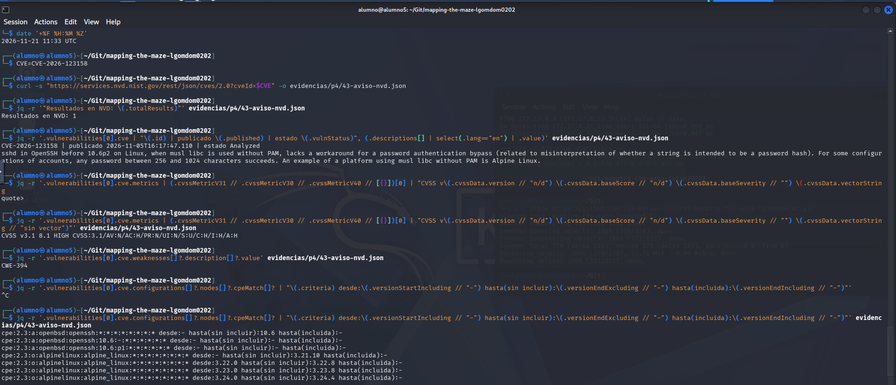
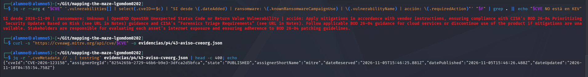
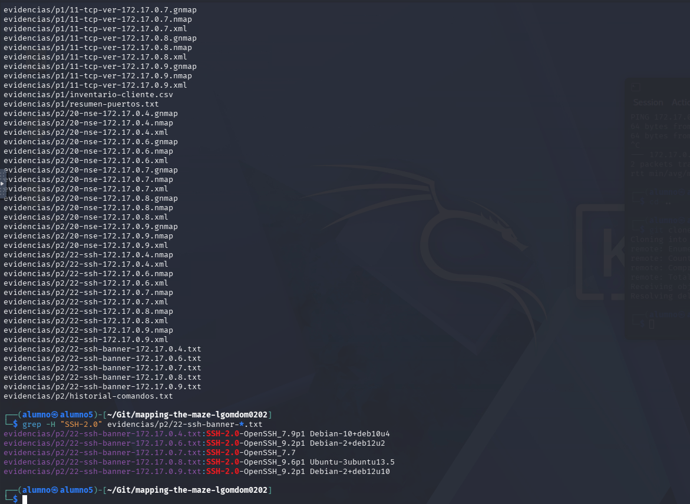
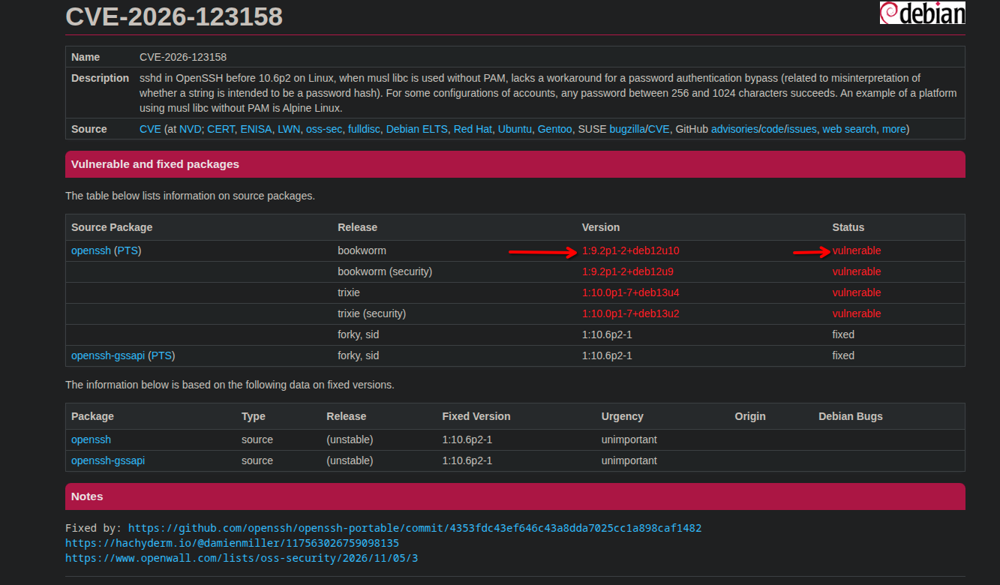
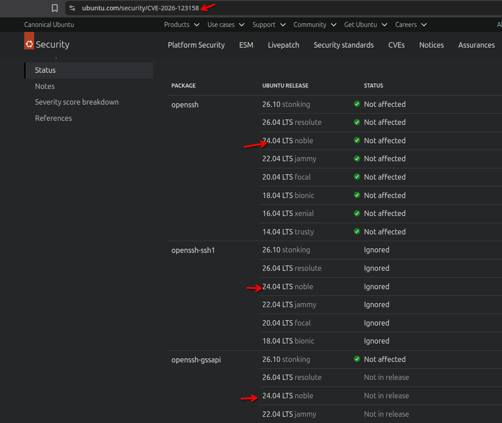
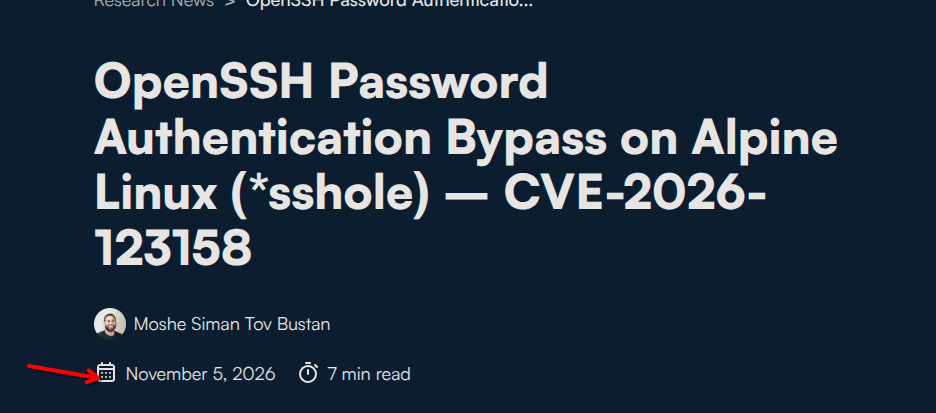
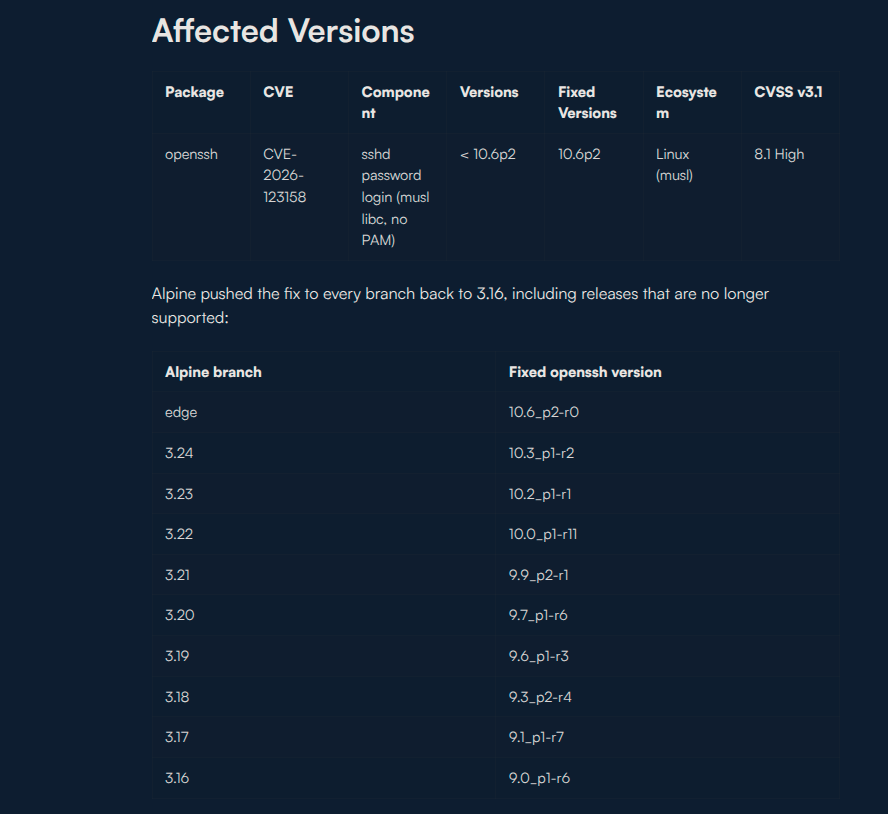

# Informe de vulnerabilidades priorizado - Gadir Logística, S.L.

**Para:** Dirección de Gadir Logística, S.L.
**Fecha:** 2026-11-23
**Elaborado por:** Luis Miguel Gomila Domínguez, Gonzalo García Vega, Natalia Alejo Pérez y Pablo
Ostenero Reyes. Cada uno revisó la red por separado, y este informe reúne y contrasta lo que
encontramos entre todos.
**Alcance:** red interna 172.17.0.0/24
**Tipo de revisión:** identificación no intrusiva. No se ha explotado ni modificado nada y
ningún servicio se ha interrumpido.

## 1. Resumen para la dirección

Hemos revisado su red interna y hemos encontrado **8 equipos activos** (su hoja de
inventario recogía 10, de los que solo 2 siguen en la red) y **15 vulnerabilidades
potenciales**. De ellas, **6 se están aprovechando ya por atacantes en el mundo real**, según
el catálogo de vulnerabilidades explotadas de la agencia de ciberseguridad de EE. UU. (CISA KEV),
y 2 de esas 6 se han usado en ataques de secuestro de datos (ransomware). Los cuatro miembros del
equipo llegamos por separado a los mismos equipos y a los mismos fallos principales; al juntar el
trabajo, algunos aportaron hallazgos que el resto no tenía: Gonzalo y Pablo, un fallo de Apache
que está en el catálogo KEV (prioridad 4), y Natalia y Gonzalo, el acceso sin contraseña a las
carpetas compartidas.
Una de las 15 es la
que nos preguntaron por la noticia («sshole»); la respuesta completa está en el apartado 5.

Con el presupuesto de este trimestre, recomendamos corregir primero estas tres:

1. **Mensajería con los operadores (172.17.0.5, programa Apache ActiveMQ 5.15.15)**: cualquiera
   que llegue a este equipo por la red podría tomar el control del servidor sin necesitar
   contraseña. Es un fallo usado en ataques de ransomware. Acción: actualizar ActiveMQ a la
   versión 5.18.3 o posterior (como mínimo 5.16.7), que corrige también el fallo de su consola
   web (prioridad 10).
2. **Servidor Jenkins (172.17.0.6, Jenkins 2.441, herramienta de automatización de tareas)**:
   un atacante sin contraseña podría leer ficheros del servidor, entre ellos claves y
   contraseñas guardadas. También se ha usado en ataques de ransomware. Acción: actualizar
   Jenkins a la versión 2.442 o posterior (o a la versión de soporte largo 2.426.3 o posterior).
3. **Aplicación web Java (172.17.0.4, Apache Tomcat 9.0.30)**: su conector interno AJP (puerto
   8009) está abierto a la red y permitiría leer ficheros de las aplicaciones, como su
   configuración con contraseñas. Acción: actualizar Tomcat a la versión 9.0.99 o posterior,
   que corrige también el fallo de prioridad 5 del mismo equipo, y cerrar el puerto 8009 a la
   red si no se usa.

**Medida urgente y de bajo coste, además de las tres anteriores: el servidor FTP (172.17.0.3).**
Funciona con vsftpd 2.3.4, una versión que se distribuyó con una puerta trasera. Esa puerta
permite a cualquiera tomar el control del equipo sin contraseña. No está en el catálogo KEV, por
eso queda en el puesto 7 por datos. Pero corregirla apenas cuesta, y si la puerta trasera es real,
el equipo podría estar ya comprometido. Recomendamos:
- Si el FTP no se usa, pararlo.
- Si se usa, sustituir vsftpd por la versión que da el sistema operativo y revisar el equipo antes
  de volver a confiar en él.

**Medida urgente y de bajo coste por la noticia del «sshole»: el equipo antiguo (172.17.0.7).**
Es el único equipo en el que no podemos descartar ese fallo (apartado 5). Recomendamos:
- Comprobar en el propio equipo si acepta entrar por SSH con contraseña y, si es así, quitarlo y
  dejar solo el acceso con clave.
- Limitar qué equipos pueden conectarse a él.
- Revisar sus registros de acceso.

No requiere comprar nada ni actualizar programas.

**Medida urgente y de bajo coste: las carpetas compartidas (172.17.0.8).** Natalia y Gonzalo
comprobaron que el servidor de ficheros deja entrar sin usuario ni contraseña: cualquiera en
la red puede ver la lista de cuentas (`usuario1` a `usuario3`, `satriani7`, `administrador`) y leer
la carpeta `myshare`, que contiene un fichero con un token de acceso de la cuenta `satriani7`
(caducado en 2024). Recomendamos quitar el acceso anónimo, borrar ese fichero y cambiar las claves
con las que se generan esos tokens. Es un cambio de configuración, sin coste.

Las prioridades 1 y 3 corrigen también otros dos fallos de la lista: la actualización de ActiveMQ
cubre el de su consola (prioridad 10) y la de Tomcat cubre el de prioridad 5. Con las tres
actualizaciones y las medidas urgentes (FTP, equipo antiguo y carpetas compartidas) quedan
atendidos los puestos 1, 2, 3, 5, 6, 7 y 10. El puesto 4 (Apache en la .3, la .5 y la .8) depende
de una configuración que no hemos podido ver; si hay margen, actualizar Apache con las
actualizaciones normales del sistema lo corrige, junto con el puesto 14.

## 2. Qué hay en su red

| Equipo | Para qué sirve | Servicios que ofrece a la red |
|---|---|---|
| 172.17.0.5 | Portal de clientes | Web en los puertos 80 y 443 (cifrada, con el certificado caducado desde abril de 2025) |
| 172.17.0.5 | Mensajería con operadores | Programa ActiveMQ en los puertos 1883, 5672, 61613, 61614 y 61616, y su consola web en el 8161 (pide contraseña). Además, en el puerto 38443 hay un servicio que no se ha podido identificar |
| 172.17.0.9 | Probablemente un servidor de pruebas: su web dice «Under Development». Podría ser el equipo donde el antiguo informático «montaba cosas», pero no se ha podido confirmar | Web «en desarrollo» con página de acceso (puerto 80) y acceso remoto SSH (puerto 22) |
| 172.17.0.10 | Consola de gestión de servidores | Gestión remota IPMI (puerto 623/udp) y una web informativa (puerto 80) |
| 172.17.0.7 | Equipo antiguo | Solo acceso remoto SSH (puerto 22), con una versión de 2018 |
| 172.17.0.3 | Servidor FTP y web (no figuraba en su hoja) | Transferencia de ficheros FTP (puerto 21) y web por defecto (puerto 80) |
| 172.17.0.4 | Aplicación web Java (no figuraba en su hoja) | Tomcat en el puerto 8080, su conector interno AJP en el 8009 y acceso remoto SSH (22) |
| 172.17.0.6 | Servidor Jenkins (no figuraba en su hoja) | Jenkins en el puerto 8080 (pide contraseña) y acceso remoto SSH (22) |
| 172.17.0.8 | Servidor de ficheros (no figuraba en su hoja) | Carpetas compartidas Samba (puertos 139, 445 y 137/udp), que admiten acceso sin contraseña; web con página de acceso (80) y acceso remoto SSH (22) |

Su hoja de inventario no está al día: 7 equipos que ya no existen, 6 equipos que no aparecían
y 2 equipos con datos erróneos. Una entrada más (172.17.1.6) queda fuera de la red que nos
autorizaron a revisar y no la hemos comprobado. Dos miembros del equipo llegaron por separado a
estas mismas cifras. El detalle está en `inventario.md`.

## 3. Vulnerabilidades por orden de prioridad

| Prioridad | Equipo | Qué le pasa | Riesgo para el negocio | Qué hacer |
|---|---|---|---|---|
| 1 | 172.17.0.5, mensajería con operadores (ActiveMQ 5.15.15) | Un atacante sin contraseña podría ejecutar órdenes en el servidor. Está en el catálogo KEV, con uso en ransomware | Control del servidor de mensajería: lectura o alteración de los mensajes con los operadores y parada de la facturación | Actualizar ActiveMQ a la 5.18.3 o posterior (mínimo 5.16.7) |
| 2 | 172.17.0.6, Jenkins 2.441 | Un atacante sin contraseña podría leer ficheros del servidor. Está en el catálogo KEV, con uso en ransomware | Robo de las claves y contraseñas que guarda Jenkins, con las que podría saltar a otros equipos | Actualizar Jenkins a la 2.442 o posterior (o LTS 2.426.3 o posterior) |
| 3 | 172.17.0.4, Tomcat 9.0.30 (conector AJP, puerto 8009) | Un atacante podría leer ficheros de las aplicaciones a través del conector AJP abierto. Está en el catálogo KEV | Robo de la configuración de las aplicaciones, que suele incluir contraseñas de bases de datos | Actualizar Tomcat a la 9.0.99 o posterior y cerrar el puerto 8009 a la red si no se usa |
| 4 y siguientes | Para próximos trimestres, salvo las medidas urgentes del apartado 1 | 4: Apache de la .3, .5 y .8 (en KEV; depende de una configuración que no hemos podido ver; aportado por Gonzalo y Pablo). 5: Tomcat de la .4 (otro fallo en KEV, que se corrige con la misma actualización de la prioridad 3). 6: SSH del equipo antiguo .7, el fallo «sshole» de la noticia (en KEV; ver el apartado 5). 7: FTP de la .3 (vsftpd 2.3.4, versión con puerta trasera; ver la medida urgente del apartado 1). 8: consola de gestión de la .10 (IPMI 2.0, permite obtener contraseñas cifradas). 9 a 15: SSH de la .6, consola de ActiveMQ (se corrige con la prioridad 1), Jetty de la .5, otros dos fallos del SSH del equipo antiguo .7 y dos fallos más de Apache que solo aplican con configuraciones que no hemos visto | Variable según el equipo; el detalle está en `registro-vulns.md` | Ver cada ficha en `registro-vulns.md` |

**Por qué este orden.** No hemos ordenado solo por la nota de gravedad técnica (CVSS). Hemos
adelantado lo que los atacantes ya están usando (catálogo KEV) o tienen mucha probabilidad de
usar en el próximo mes (indicador EPSS), y lo que afecta a los equipos de los que depende la
facturación. Por eso un fallo de gravedad media pero explotado activamente aparece antes que
otro con nota más alta pero sin ataques conocidos.

## 4. Advertencias

- El equipo **172.17.0.7** es antiguo y delicado: cualquier prueba agresiva puede tumbarlo.
  Recomendamos planificar su sustitución y aislarlo del resto de la red.
- Hay hallazgos graves que **no hemos tocado**, como pedía el contrato, y que deberían
  confirmarse en una siguiente fase con su permiso: el FTP de la 172.17.0.3 (vsftpd 2.3.4, una
  versión distribuida con una puerta trasera; si se confirma, el equipo debe darse por
  comprometido), la mensajería ActiveMQ de la 172.17.0.5, el Jenkins de la 172.17.0.6, el
  conector AJP de Tomcat en la 172.17.0.4 y la consola de gestión IPMI de la 172.17.0.10, que
  anuncia entre sus métodos de acceso uno sin contraseña (`null`); no hemos comprobado si
  está activo.
- Además de los fallos con CVE, hay **errores de configuración** que se corrigen sin coste. Los
  más importantes:
  - La consola de gestión (172.17.0.10) admite acceso sin contraseña entre sus métodos.
  - Las carpetas compartidas (172.17.0.8) no exigen firma.
  - El certificado del portal de clientes (172.17.0.5) está caducado desde abril de 2025.
  - La mensajería (172.17.0.5) acepta conexiones MQTT y STOMP sin pedir contraseña.
  - Las carpetas compartidas (172.17.0.8) dejan ver las cuentas y leer la carpeta `myshare` sin
    contraseña (ver la medida urgente del apartado 1).
  - La web de Tomcat (172.17.0.4) anuncia sus páginas de administración.
  
  La lista completa está en `registro-vulns.md`, apartado «Hallazgos de configuración sin CVE».
- Todo lo indicado es **potencial**: se basa en las versiones observadas desde la red, no en
  haber atacado los equipos.

## 5. Respuesta a su consulta sobre la noticia (CVE-2026-123158, «sshole»)

**¿Les afecta?** **No podemos descartarlo en un equipo, el antiguo (172.17.0.7).** En los otros
cuatro equipos que usan SSH, según lo observado, no.

- **Qué es:** un fallo en OpenSSH, el programa con el que se entra en remoto a los servidores
  (SSH, el acceso que usaba su antiguo informático). Se publicó el 5 de noviembre de 2026. Solo
  aparece en servidores Linux que usan una pieza concreta del sistema (la biblioteca «musl», típica
  de Alpine Linux y de algunos equipos pequeños o integrados) y que no usan el módulo de
  autenticación PAM. En esos servidores, escribiendo una contraseña muy larga (de 256 a 1024
  caracteres) se puede entrar en ciertas cuentas sin saber su contraseña. Se corrige con la versión
  10.6p2 de OpenSSH.
  - Gravedad técnica (CVSS, nota de 0 a 10): **8,1, alta**. No llega a crítica porque necesita
    que se den a la vez varias condiciones del sistema.
  - Probabilidad de que se use en un ataque en los próximos 30 días (EPSS): **19 %** el 20 de
    noviembre y **96 %** el 23 de noviembre, según la consulta más reciente, hecha por Pablo. En tres días ha pasado a estar entre el 0,2 % de vulnerabilidades con más probabilidad
    de ser usadas: es un motivo más para aplicar ya la medida del equipo antiguo.
  - **Sí figura en el catálogo KEV de CISA** (vulnerabilidades que los atacantes ya están usando)
    desde el 9 de noviembre de 2026. No consta que se haya usado en ataques de ransomware. CISA
    pide, además de corregirlo, revisar si alguien ya ha entrado.
  - Lo que decía el correo de su vecino es correcto, con un matiz importante: no afecta a todos
    los servidores con SSH, solo a los que cumplen esas condiciones.
- **Lo que podemos sostener con nuestras pruebas:**
  - En su red hay **cinco equipos con OpenSSH** (172.17.0.4, .6, .7, .8 y .9). En todos, la versión
    es anterior a la 10.6p2.
  - **172.17.0.4, .6 y .9** se identifican como Debian, y **172.17.0.8** como Ubuntu. Esos
    sistemas no usan «musl», sino otra biblioteca (glibc), y el artículo de la noticia los cita
    expresamente entre los no afectados. Ubuntu declara su versión «no afectada». Debian la marca
    como vulnerable solo por el número de versión, pero le da la urgencia más baja
    («unimportant»). **Según lo observado, a estos cuatro no les afecta.**
  - **172.17.0.7** (el equipo antiguo) tiene OpenSSH 7.7, dentro de las versiones afectadas, y no
    muestra de qué sistema es. No podemos saber desde fuera si usa «musl» ni cómo está
    configurado: por eso **no podemos descartarlo**. Gonzalo lanzó una detección de sistema
    operativo y el equipo responde como Linux, que es una de las condiciones del fallo; no revela si
    usa «musl».
  - Los cuatro miembros del equipo revisamos este aviso por separado. Pablo llegó a la misma
    conclusión. Gonzalo concluyó que con lo observado no se puede afirmar que ninguno de los cinco
    sea vulnerable y dejó la comprobación final para hacerla desde dentro. La única diferencia está
    en los cuatro equipos Debian y Ubuntu, que aquí descartamos por las declaraciones oficiales de
    Debian, Ubuntu y el propio artículo.
  - Evidencias: `evidencias/EVIDENCIAS_LUISMI/p2/22-ssh-banner-*.txt` (versión de cada equipo) y
    `evidencias/EVIDENCIAS_LUISMI/p4/43-aviso-*.json` (NVD, cve.org, EPSS y KEV);
    `evidencias/EVIDENCIAS_PABLO/p4/43-aviso-epss.json` (EPSS del 23 de noviembre) y
    `evidencias/EVIDENCIAS_GONZALO/os-172-17-0-7.nmap` (sistema de la .7).
- **Lo que queda pendiente de comprobar** (desde dentro del equipo 172.17.0.7, con su permiso):
  - de qué sistema es y si usa «musl»;
  - si su SSH admite entrar con contraseña;
  - si tiene cuentas sin contraseña;
  - si en sus registros hay accesos sospechosos.
  
  Ninguna de estas cosas se puede ver desde la red sin intentar entrar, y probarlo sería atacar el
  equipo, algo que el contrato no permite. También queda la limitación de siempre: solo vemos lo
  que estaba encendido y accesible durante la revisión.
- **Recomendación:**
  1. **Esta semana, en 172.17.0.7:** que la persona que lleve ahora sus sistemas compruebe esos
     cuatro puntos. Si admite contraseña, que lo desactive (solo acceso con clave) y limite qué
     equipos pueden conectarse a él. Es un cambio de configuración, sin coste. Si aparece un
     acceso sospechoso, el equipo debe darse por comprometido. A medio plazo, este equipo debería
     sustituirse: su versión de SSH es de 2018 y arrastra otros fallos (prioridades 12 y 13).
  2. **En los otros cuatro equipos** no hace falta ninguna acción por este fallo. Aun así, el SSH de
     172.17.0.6 está desactualizado por otro motivo (prioridad 9).
  3. **Como medida general**, ya que su antiguo informático entraba a los servidores por SSH y ya
     no está: cambiar las contraseñas y retirar las claves de acceso que usaba en todos los
     equipos.

## 6. Fuentes y fecha

NVD, FIRST EPSS, CISA KEV, MITRE CWE y MITRE ATT&CK, consultados el 2026-11-18 (valores de EPSS del 2026-11-17 y catálogo KEV
versión 2026.11.17). Para el aviso de la noticia, además, cve.org y los avisos de seguridad de
Debian y Ubuntu, consultados el 2026-11-21 (valores de EPSS del 2026-11-20 y catálogo KEV versión
2026.11.20). El artículo que nos reenviaron (OX Security, 5 de noviembre de 2026) se usó solo
para contrastar: los datos de este informe salen de las fuentes oficiales.
Los datos que aportaron otros miembros del equipo llevan su propia fecha: EPSS y KEV consultados
por Gonzalo el 2026-11-19, fichas de NVD descargadas por Pablo el 2026-11-22 y el EPSS del aviso
consultado por Pablo el 2026-11-23.
El detalle técnico está en `registro-vulns.md` y en los cuadernos de trabajo de los cuatro
integrantes.
