# Inventario de red - Gadir Logística, S.L.

**Alcance:** 172.17.0.0/24 (scope.txt)
**Fecha de las comprobaciones:** 2026-11-17 (horas en UTC, hora de la máquina Kali)
**Autor:** Luis Miguel Gomila Domínguez
**Criterio de evaluación:** RA3.b, inventario de equipos mediante técnicas activas.

## Método

- Descubrimiento activo con nmap combinando ICMP, TCP SYN/ACK, UDP y ARP, sin escanear puertos.
  Resultado: `evidencias/p1/vivos.txt`.
- Pasada suave a cada equipo vivo (100 puertos más comunes, `-sV --version-light`, `-T2`) para
  localizar el equipo delicado antes de escanear a fondo.
- Escaneo de los 65 535 puertos TCP de cada equipo (`-p-`) con velocidad limitada (`--max-rate`)
  y de los 100 puertos UDP más comunes. El 2026-11-19 se amplió UDP a los 1000 más comunes en todos
  los equipos salvo el delicado, y a los 100 más comunes en el delicado, a muy baja velocidad.
- Detección de versión (`-sV`) sobre los puertos TCP abiertos, sin detección activa de sistema
  operativo (`-O`) para no enviar tráfico innecesario.
- Sin scripts intrusivos ni de explotación. Los comandos exactos y sus horas están en el
  [cuaderno](cuadernos/luis-miguel-gomila-dominguez.md).
- Mi IP de trabajo, **172.17.0.1** (interfaz `docker0`), responde en la red pero no forma parte
  del cliente y se excluye del inventario.

### Decisiones de la Parte 1 y por qué

| Decisión | Por qué | Dónde se ve |
|---|---|---|
| No usar la hoja del cliente como fuente; contrastarla solo al final | La hoja no es fiable. Si se partiera de ella, los equipos que no figuran en la hoja no se buscarían | «Correcciones al inventario del cliente» |
| Todo contra `scope.txt` (172.17.0.0/24); la 172.17.1.6 de la hoja no se toca | El alcance es la frontera legal del encargo: lo de fuera no se toca aunque el cliente lo mencione | `scope.txt`; barridos «256 IP addresses» |
| Descubrimiento con varias sondas a la vez (ICMP echo y timestamp, TCP SYN a 9 puertos típicos, TCP ACK al 80, UDP al 53 y 161) y sin escanear puertos | Un equipo que filtre ICMP no responde a un ping normal, pero sí suele contestar a alguna sonda TCP o UDP. Sin escanear puertos, el barrido de 256 IP dura segundos | `evidencias/p1/01-descubrimiento.*` |
| Repetir el descubrimiento con ARP (`-PR`) y comparar con `diff` | En la misma red local un equipo puede ignorar ICMP, TCP y UDP, pero no ARP. Que los dos barridos coincidan confirma que no hay equipos ocultos | `evidencias/p1/02-descubrimiento-arp.*`, captura p1-02 («COINCIDEN») |
| Pasada suave antes del escaneo completo (100 puertos más comunes, `-sV --version-light`, `-T2`, `--max-retries 1`) | Para saber qué equipo es el antiguo y delicado **antes** de lanzarle un escaneo pesado, enviando poco tráfico | `evidencias/p1/03-suave-*` |
| Elegir 172.17.0.7 como equipo delicado por la antigüedad de su software | Los tiempos de respuesta no distinguían a ningún equipo (todos son contenedores del mismo anfitrión). La única señal objetiva era el software: OpenSSH 7.7 de 2018, sin paquete de distribución | Apartado «Equipo antiguo y delicado» |
| Vigilar el equipo delicado con `ping` en otra terminal mientras se escanea | Si el escaneo lo degradara, se vería enseguida en la pérdida de paquetes y se podría parar | Captura p1-04 (43 enviados, 43 recibidos) |
| Escanear los 65 535 puertos TCP (`-p-`) de todos los equipos | Los servicios no tienen por qué estar en puertos habituales. Gracias a esto apareció la mensajería real (ActiveMQ), en 7 puertos altos de la .5 que la pasada suave no vio | «Puertos fuera de lo habitual» |
| Equipos normales: `-T3 --max-rate 200` | Un primer intento con `-T2 --max-rate 30` era demasiado lento para siete equipos que no son delicados y se canceló. Con 200 paquetes por segundo como máximo, cada equipo tardó unos 328 segundos sin cargar la red | Cuaderno, entradas de las 15:43 y las 16:12 |
| Equipo delicado: `--max-rate 30 --max-retries 1` | Como mucho 30 paquetes por segundo y un solo reintento, para no saturarlo. Con `-T2` estimaba más de 6 horas y se cambió a `-T3`, pero el límite real sigue siendo `--max-rate 30`. Tardó 2 185 segundos y siguió respondiendo | Cuaderno, entrada de las 16:54 |
| Detección de versión (`-sV`) solo sobre los puertos ya encontrados abiertos | Lanzar `-sV` sobre los 65 535 puertos repetiría el escaneo completo con sondas más pesadas. Sobre los abiertos basta. En el equipo delicado, con `--version-light -T2` | `evidencias/p1/11-tcp-ver-*` |
| Sin detección de sistema operativo (`-O`) ni `-A` | `-O` envía sondas TCP, UDP e ICMP poco habituales (también a puertos cerrados), es tráfico extra que puede afectar a un equipo frágil y el dato no es imprescindible: el sistema se deduce de los banners | «Sistema operativo (deducido de los banners)» |
| UDP primero en los 100 puertos más comunes (10 en el equipo delicado), con `--max-retries 1`, `--max-rate 100` y `--version-intensity 0` | En UDP un puerto abierto a menudo no responde: nmap tiene que esperar y reintentar en cada uno, y Linux limita las respuestas de «puerto cerrado». Los 65 535 puertos habrían tardado horas por equipo. Los 100 más comunes incluyen los servicios UDP habituales (DNS, DHCP, TFTP, NTP, NetBIOS, SNMP, IPMI) | «UDP» |
| Ampliar después UDP a los 1000 más comunes (100 en el equipo delicado, con `-T2 --max-rate 10` y sin `-sV`) | Reducir la parte de UDP sin revisar. Se usaron los mismos límites de velocidad, unos 2 minutos por equipo. El equipo delicado se escaneó diez veces más despacio y sin sondas de versión | `evidencias/p1/13-udp-*` |
| No contar como abiertos los puertos UDP `open\|filtered` | Que no respondan no demuestra que estén abiertos: también pueden estar filtrados. Solo se cuentan los que respondieron | «UDP» |
| Marcar la función de cada equipo como «probable» | Se deduce de los servicios que expone, no de una comprobación dentro del equipo | Tabla de la Parte 1 |

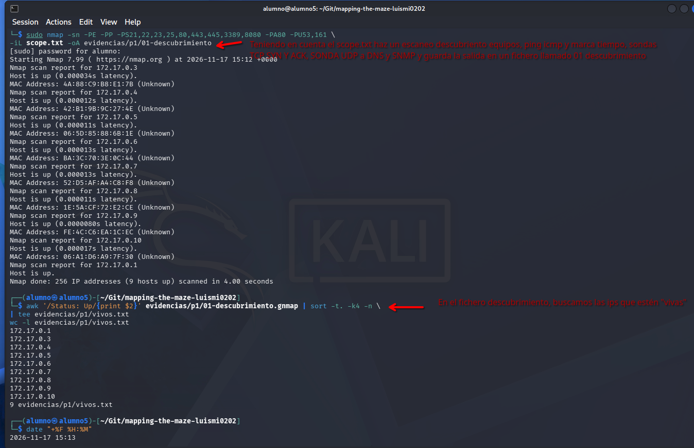

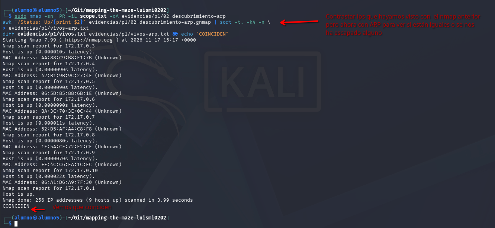

### Equipo antiguo y delicado: 172.17.0.7

- **Conclusión:** 172.17.0.7 es el **equipo delicado más probable**, no un dato confirmado. Ningún
  equipo mostró degradación ni se cayó con los escaneos a velocidad limitada, así que la
  identificación se basa en la antigüedad del software y no en un fallo observado.
- **Por qué es este:** es el sistema más antiguo de la red. Su único servicio es SSH con
  **OpenSSH 7.7** (2018) y el banner no incluye paquete de ninguna distribución, lo que apunta a
  un sistema viejo o compilado a mano. El resto de equipos muestran Debian 12 o Ubuntu 24.04;
  solo 172.17.0.4 es también antiguo (Debian 10), pero sirve Tomcat, un servidor robusto.
- **Lo que no permitió distinguirlo:** en la pasada suave todos los equipos respondieron igual
  (srtt entre 40 y 55 µs, rttvar entre 3 y 11, sin avisos de retransmisión), porque son
  contenedores del mismo anfitrión. Lo delicado no se aprecia en reposo.
- **Cómo se escaneó:** pasada suave con `-T2`; escaneo completo de puertos con `--max-rate 30` y
  `--max-retries 1` (un primer intento con `-T2` se canceló porque estimaba más de 6 horas);
  versión del puerto 22 con `--version-light -T2`; UDP solo sobre 10 puertos típicos. Sin `-O`.
  La pasada suave se vigiló con `ping` en paralelo (43 paquetes enviados, 43 recibidos, 0 % de
  pérdida) y el equipo siguió respondiendo durante todo el trabajo.
- **Otro candidato, 172.17.0.10:** expone IPMI (623/udp), el protocolo propio de las consolas de
  gestión fuera de banda (BMC), que suelen ser frágiles ante el tráfico de escaneo. Por eso también
  se trató con prudencia: velocidad limitada (`--max-rate 200` en TCP, `--max-rate 100` y un solo
  reintento en UDP), sin `-O` y, durante la Parte 2, vigilado con `ping` (516 paquetes enviados,
  516 recibidos, 0 % de pérdida, visible al fondo de las capturas de la Parte 2). No mostró
  degradación.

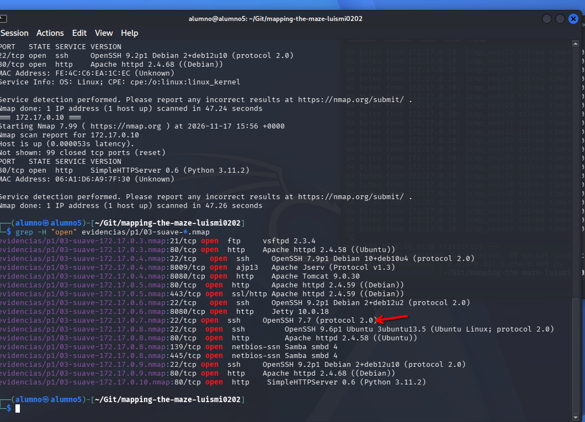

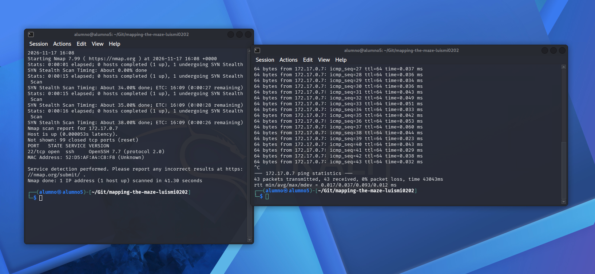

## Parte 1 - Equipos vivos, puertos y servicios

**Equipos vivos del cliente:** 8 (172.17.0.3 a 172.17.0.10), con 24 puertos TCP y 2 puertos
UDP abiertos en total (`evidencias/p1/vivos.txt`, `evidencias/p1/resumen-puertos.txt`).

| IP | Función probable | Puerto | Proto | Servicio | Producto y versión | Evidencia |
|---|---|---|---|---|---|---|
| 172.17.0.3 | Servidor FTP y web | 21 | tcp | ftp | vsftpd 2.3.4 | `evidencias/p1/11-tcp-ver-172.17.0.3.nmap` |
| 172.17.0.3 | | 80 | tcp | http | Apache httpd 2.4.58 (Ubuntu) | idem |
| 172.17.0.4 | Aplicación web Java (Tomcat) | 22 | tcp | ssh | OpenSSH 7.9p1 Debian 10+deb10u4 | `evidencias/p1/11-tcp-ver-172.17.0.4.nmap` |
| 172.17.0.4 | | 8009 | tcp | ajp13 | Apache Jserv (Protocol v1.3) | idem |
| 172.17.0.4 | | 8080 | tcp | http | Apache Tomcat 9.0.30 | idem |
| 172.17.0.5 | Portal de clientes y mensajería con operadores (broker ActiveMQ) | 80 | tcp | http | Apache httpd 2.4.59 (Debian) | `evidencias/p1/11-tcp-ver-172.17.0.5.nmap` |
| 172.17.0.5 | | 443 | tcp | ssl/http | Apache httpd 2.4.59 (Debian) | idem |
| 172.17.0.5 | | 1883 | tcp | mqtt | no identificada | idem |
| 172.17.0.5 | | 5672 | tcp | amqp | ActiveMQ (AMQP; nmap no la nombra, pero la respuesta del servicio es AMQP) | idem |
| 172.17.0.5 | | 8161 | tcp | http | Jetty 9.4.39.v20210325 (consola web de ActiveMQ) | idem |
| 172.17.0.5 | | 38443 | tcp | tcpwrapped | no identificado (acepta la conexión y la cierra) | idem |
| 172.17.0.5 | | 61613 | tcp | stomp | Apache ActiveMQ | idem |
| 172.17.0.5 | | 61614 | tcp | http | Jetty 9.4.39.v20210325 (ActiveMQ por WebSocket) | idem |
| 172.17.0.5 | | 61616 | tcp | apachemq | ActiveMQ OpenWire transport 5.15.15 | idem |
| 172.17.0.6 | Aplicación web Java (Jetty); en la Parte 2 se identificó como Jenkins 2.441 | 22 | tcp | ssh | OpenSSH 9.2p1 Debian 2+deb12u2 | `evidencias/p1/11-tcp-ver-172.17.0.6.nmap` |
| 172.17.0.6 | | 8080 | tcp | http | Jetty 10.0.18 | idem |
| 172.17.0.7 | **Equipo antiguo y delicado** | 22 | tcp | ssh | OpenSSH 7.7 (protocol 2.0) | `evidencias/p1/11-tcp-ver-172.17.0.7.nmap` |
| 172.17.0.8 | Servidor de ficheros (Samba, nombre SAMBASERVER) | 22 | tcp | ssh | OpenSSH 9.6p1 Ubuntu 3ubuntu13.5 | `evidencias/p1/11-tcp-ver-172.17.0.8.nmap` |
| 172.17.0.8 | | 80 | tcp | http | Apache httpd 2.4.58 (Ubuntu) | idem |
| 172.17.0.8 | | 139 | tcp | netbios-ssn | Samba smbd 4 | idem |
| 172.17.0.8 | | 445 | tcp | netbios-ssn | Samba smbd 4 | idem |
| 172.17.0.8 | | 137 | udp | netbios-ns | Samba nmbd netbios-ns (workgroup: DL) | `evidencias/p1/12-udp-172.17.0.8.nmap` |
| 172.17.0.9 | Servidor web | 22 | tcp | ssh | OpenSSH 9.2p1 Debian 2+deb12u10 | `evidencias/p1/11-tcp-ver-172.17.0.9.nmap` |
| 172.17.0.9 | | 80 | tcp | http | Apache httpd 2.4.68 (Debian) | idem |
| 172.17.0.10 | Servidor web casero y posible interfaz de gestión (IPMI) | 80 | tcp | http | SimpleHTTPServer 0.6 (Python 3.11.2) | `evidencias/p1/11-tcp-ver-172.17.0.10.nmap` |
| 172.17.0.10 | | 623 | udp | asf-rmcp | RMCP/IPMI, versión no identificada | `evidencias/p1/12-udp-172.17.0.10.nmap` |

> La función de cada equipo es **probable**: se deduce de los servicios que expone. Se
> confirmará en la Parte 2 con la enumeración de cada servicio.

> Los nombres de servicio que muestra el escaneo completo (`10-tcp-all-*`, captura p1-05), como
> `http-proxy`, `patrol-snmp` o `unknown`, son los que nmap asigna solo por el número de puerto.
> Los válidos son los de la detección de versión (`11-tcp-ver-*`, capturas p1-06).

### Capturas por equipo

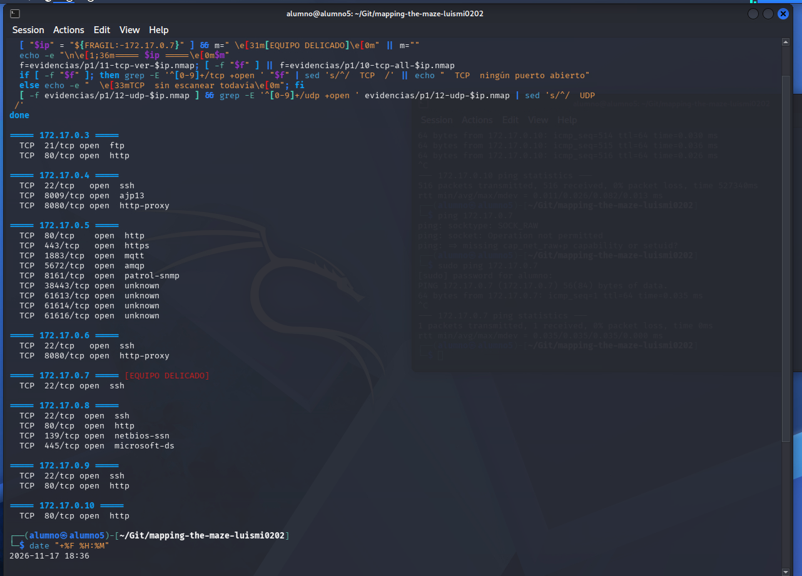

**172.17.0.3**

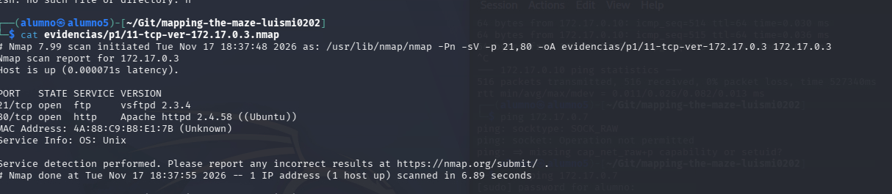

**172.17.0.4**

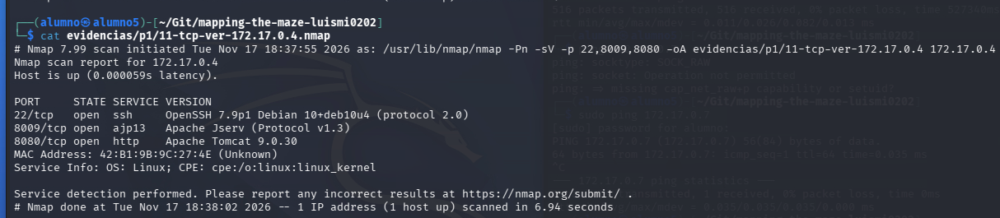

**172.17.0.5**

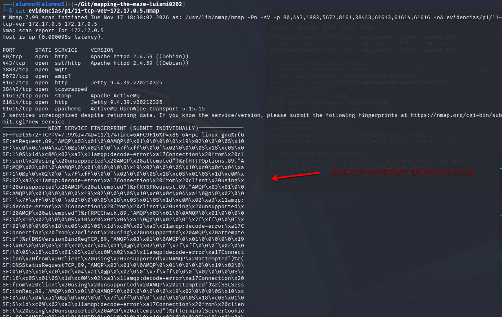

**172.17.0.6**

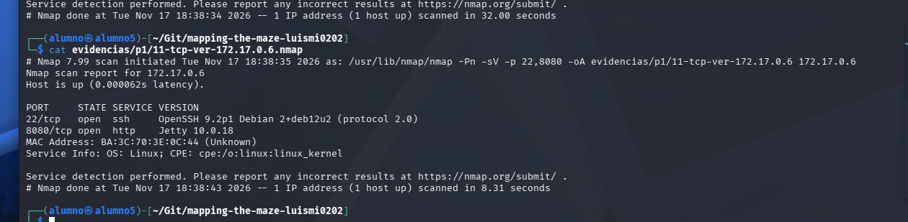

**172.17.0.7 - Equipo antiguo y delicado**

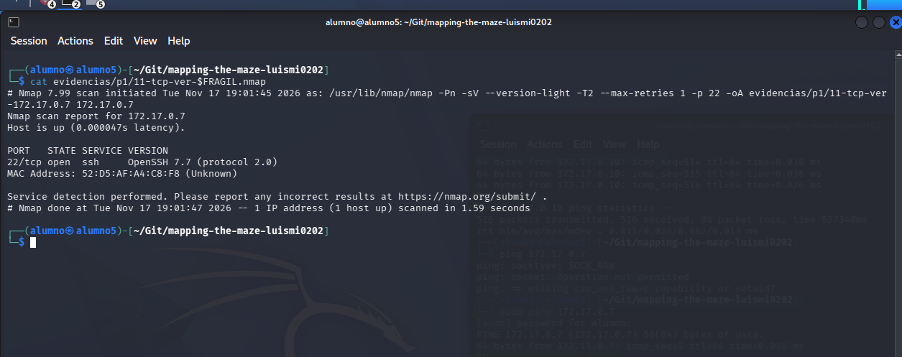

**172.17.0.8**

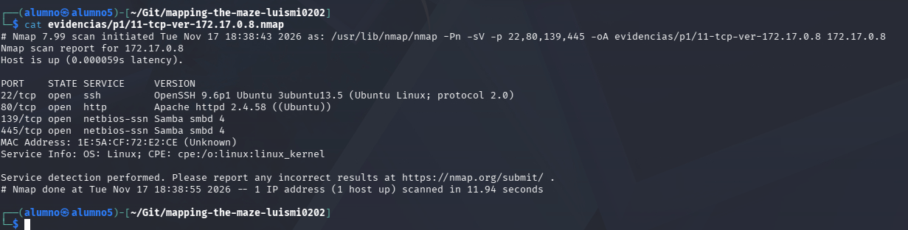

**172.17.0.9**

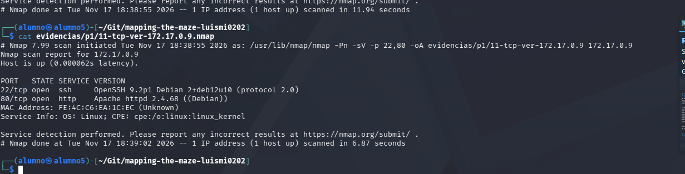

**172.17.0.10**

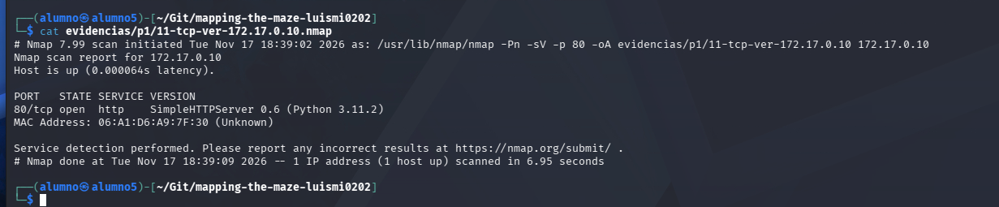

### Puertos fuera de lo habitual
Encontrados gracias al escaneo completo (`-p-`); no aparecían en la pasada suave de los 100
puertos más comunes:
- 172.17.0.5: 1883/tcp (MQTT), 5672/tcp (AMQP), 8161/tcp (consola web de ActiveMQ),
  38443/tcp (no identificado), 61613/tcp (STOMP), 61614/tcp (WebSocket de ActiveMQ) y
  61616/tcp (ActiveMQ OpenWire 5.15.15). Es el broker de mensajería: la «mensajería que conecta
  con los operadores» que menciona el cliente solo aparece en estos puertos altos.

### UDP
- Abiertos confirmados: 172.17.0.8:137/udp (NetBIOS de Samba, grupo de trabajo DL) y
  172.17.0.10:623/udp (RMCP/IPMI, protocolo de gestión remota de servidores).
- Sin confirmar: el resto de puertos UDP de cada equipo quedaron como `open|filtered` (entre 90 y
  93 por equipo) porque el servicio no respondió. No se cuentan como abiertos. Nmap avisó de
  «retransmission cap hit»: se limitó a propósito a un reintento por puerto para no cargar la red,
  y Linux limita las respuestas ICMP de puerto cerrado, así que no se pudieron confirmar.
- 172.17.0.7 (equipo delicado): en la primera pasada solo se comprobaron 10 puertos UDP típicos;
  todos cerrados salvo 69/udp (TFTP), que quedó como `open|filtered` sin confirmar.
- **Ampliación del 2026-11-19** (`evidencias/p1/13-udp-*`):
  - **Los 1000 puertos UDP más comunes** en 172.17.0.3, .4, .5, .6, .8, .9 y .10 (23:15 a 23:28
    UTC, unos 115 segundos por equipo). Solo aparecen abiertos los mismos dos puertos que en la
    Parte 1: 137/udp en la .8 y 623/udp en la .10. En cada equipo quedan entre 970 y 974 puertos
    `open|filtered` sin respuesta y entre 26 y 29 cerrados.
  - **Los 100 puertos UDP más comunes en la .7** (23:34 a 23:35 UTC, `-T2 --max-rate 10`, sin
    `-sV`): 90 cerrados y 10 `open|filtered` sin confirmar (53, 161, 1026, 1028, 9200, 31337,
    32771, 49182, 49190 y 49193). Ninguno abierto confirmado.
  - **El 69/udp (TFTP) de la .7 ahora sale cerrado.** En la primera pasada había quedado
    `open|filtered`. Al ir más despacio, el equipo tuvo tiempo de contestar con «puerto
    inalcanzable» a 90 de los 100 puertos. Esto confirma que un `open|filtered` no es un puerto
    abierto: a menudo es un puerto cerrado cuya respuesta ICMP limitó Linux. Por la misma razón,
    los 10 `open|filtered` que quedan en la .7 probablemente estén cerrados.
  - **Vigilancia:** la .10 y la .7 estuvieron vigiladas con `ping` durante el escaneo. No se
    perdió ningún paquete.
  - **Conclusión:** con 1000 puertos UDP no aparece ningún servicio nuevo. La única parte de UDP
    sin revisar son los puertos fuera de los 1000 más comunes, y los 900 siguientes en el equipo
    delicado.

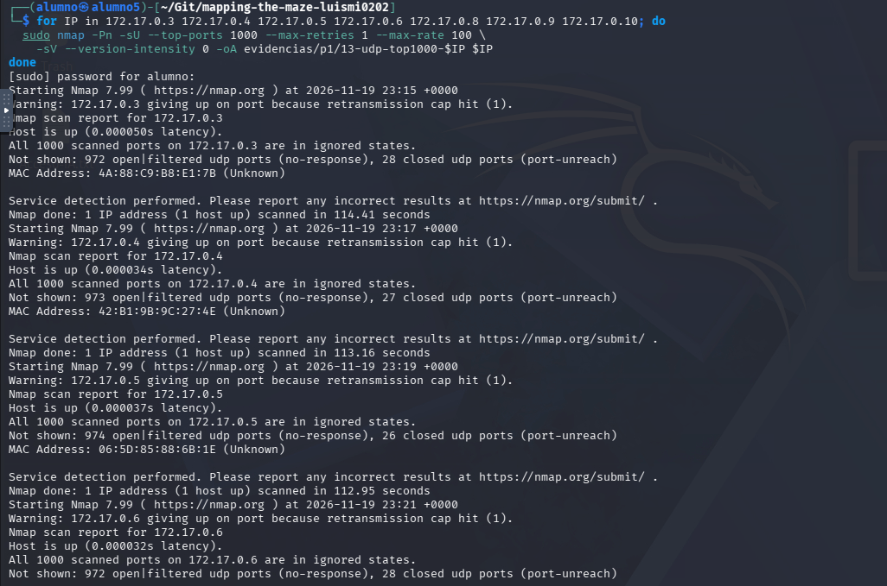

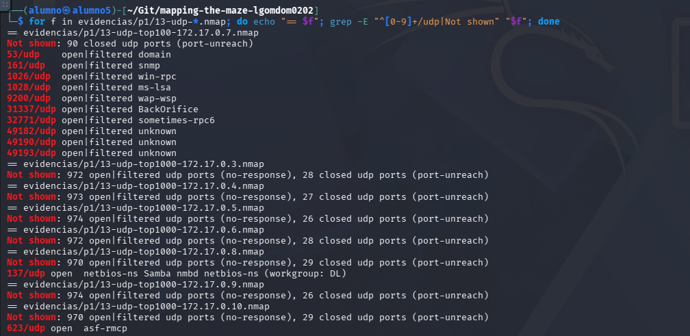

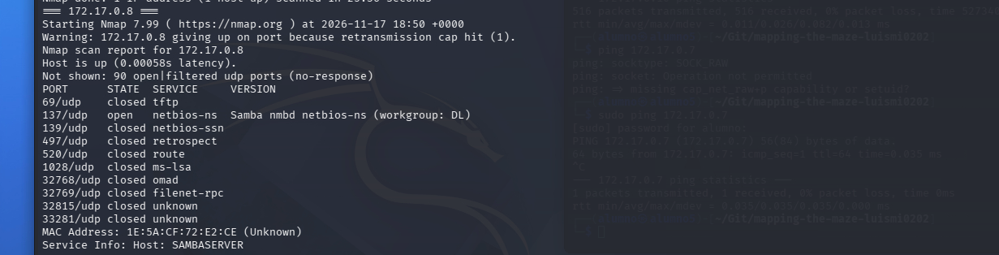

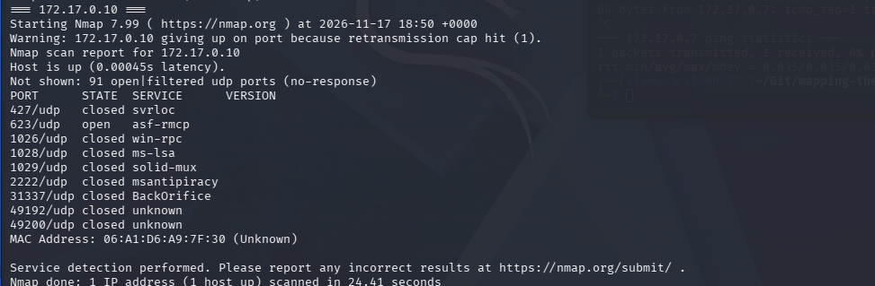

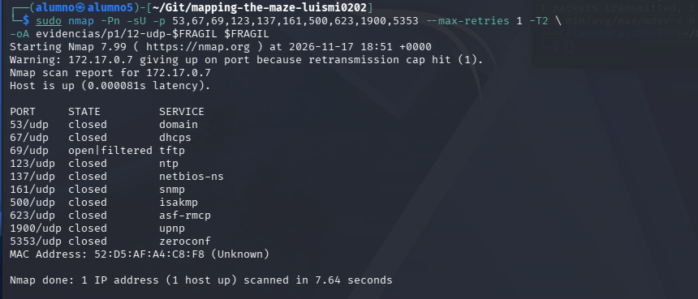

Capturas del resto de escaneos UDP, sin puertos abiertos confirmados:
[172.17.0.3](imagenes/p1-07-udp-172.17.0.3.png),
[172.17.0.4](imagenes/p1-07-udp-172.17.0.4.png),
[172.17.0.5](imagenes/p1-07-udp-172.17.0.5.png),
[172.17.0.6](imagenes/p1-07-udp-172.17.0.6.png),
[172.17.0.9](imagenes/p1-07-udp-172.17.0.9.png).

### Sistema operativo (deducido de los banners)
No se usó detección activa de sistema operativo (`-O`) para no enviar tráfico innecesario.

| IP | Sistema operativo según banners | De dónde sale |
|---|---|---|
| 172.17.0.3 | Unix, con Apache de Ubuntu | Service Info: OS: Unix; banner de Apache (Ubuntu) |
| 172.17.0.4 | Linux Debian 10 | OpenSSH 7.9p1 Debian 10+deb10u4; Service Info: OS: Linux |
| 172.17.0.5 | Linux Debian | Banner de Apache (Debian) |
| 172.17.0.6 | Linux Debian 12 | OpenSSH 9.2p1 Debian 2+deb12u2; Service Info: OS: Linux |
| 172.17.0.7 | No identificado (sistema antiguo) | OpenSSH 7.7 sin paquete de distribución |
| 172.17.0.8 | Linux Ubuntu | OpenSSH 9.6p1 Ubuntu 3ubuntu13.5; Service Info: Host: SAMBASERVER |
| 172.17.0.9 | Linux Debian 12 | OpenSSH 9.2p1 Debian 2+deb12u10; Service Info: OS: Linux. Apache 2.4.68 es la versión que distribuye Debian 12 (`2.4.68-1~deb12u1`), ver la nota siguiente |
| 172.17.0.10 | No identificado | Solo muestra Python 3.11.2 |

**Verificación del banner de Apache 2.4.68 (172.17.0.9).** Era la versión más alta de Apache de
la red, así que se comprobó que no fuera un banner inventado. El 2026-11-19 a las 22:52 UTC se
consultaron fuentes públicas, sin tocar la red del cliente:
- El registro de cambios oficial de Apache incluye la 2.4.68; la última publicada es la 2.4.71.
- Debian 12 (bookworm) distribuye `2.4.68-1~deb12u1`.

El banner es coherente con un Debian 12 actualizado, igual que su OpenSSH `deb12u10`. Evidencias:
`evidencias/p3/34-apache-versiones-publicadas.txt`, `evidencias/p3/34-apache-debian.txt`,
[captura](imagenes/p3-05-apache-2.4.68.png).

### Hallazgos graves detectados (no se han tocado)
Según las reglas de compromiso, se anotan y se avisan sin comprobarlos. Se estudian en la Parte 3:
- **172.17.0.3:21 - vsftpd 2.3.4:** versión conocida por llevar una puerta trasera. Solo se ha
  leído el banner; no se ha iniciado sesión ni lanzado ningún script sobre ella.
- **172.17.0.5:61616 - ActiveMQ 5.15.15:** versión del broker de mensajería expuesta en la red
  interna, pendiente de analizar en la Parte 3.

## Correcciones al inventario del cliente

Hoja del cliente (`evidencias/p1/inventario-cliente.csv`) comparada con lo observado el
2026-11-17. La hoja no se usó como fuente; solo se contrastó al final.

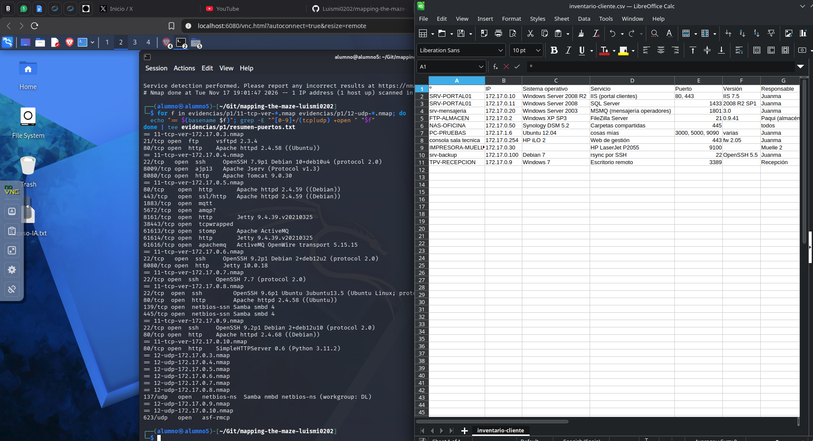

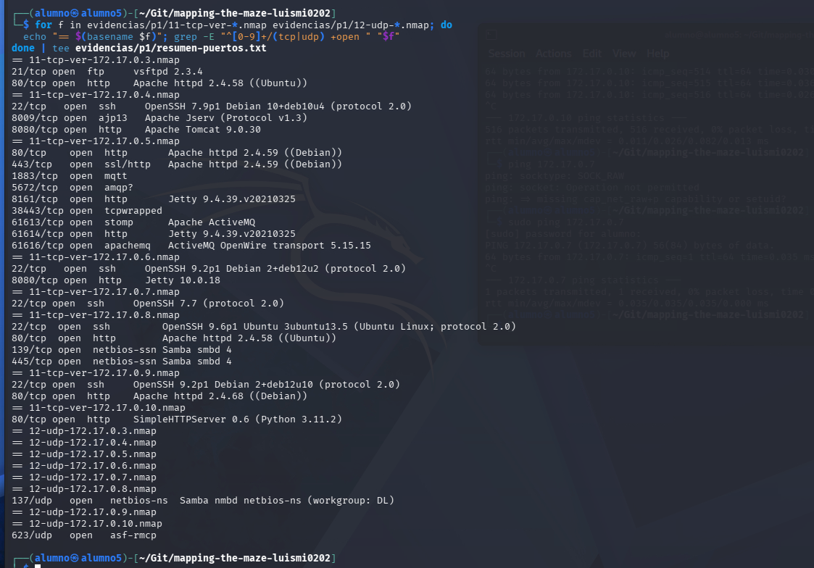

| Entrada de la hoja | Lo observado | Corrección | Tipo |
|---|---|---|---|
| SRV-PORTAL01, 172.17.0.10, Windows Server 2008 R2, IIS 7.5 en 80 y 443 | En 172.17.0.10 hay un servidor web de Python (SimpleHTTPServer 0.6) solo en el 80, y además IPMI en 623/udp. No hay IIS ni 443 | Equipo, sistema y servicio incorrectos. El portal web con HTTPS (80 y 443) está en 172.17.0.5 (Apache 2.4.59, Debian) | Mal |
| SRV-PORTAL01, 172.17.0.11, Windows Server 2008, SQL Server 2008 R2 SP1 en 1433 | 172.17.0.11 no responde a ninguna sonda del descubrimiento (tampoco a ARP); ningún equipo vivo expone 1433 | Dar de baja o comprobar físicamente | Sobra |
| srv-mensajeria, 172.17.0.20, Windows Server 2003, MSMQ 3.0 en 1801 | 172.17.0.20 no responde; nadie expone 1801. La mensajería real es un broker ActiveMQ 5.15.15 en 172.17.0.5 (puertos 1883, 5672, 8161, 61613, 61614 y 61616) | Dar de baja y registrar el broker ActiveMQ de 172.17.0.5 (fila «Falta») | Sobra |
| FTP-ALMACEN, 172.17.0.2, Windows XP SP3, FileZilla Server 0.9.41 en 21 | 172.17.0.2 no responde. Hay un FTP en 172.17.0.3, pero es vsftpd 2.3.4 sobre Unix | Dar de baja y registrar el FTP de 172.17.0.3 con su sistema y software reales (fila «Falta») | Sobra |
| NAS-OFICINA, 172.17.0.50, Synology DSM 5.2, 445 | 172.17.0.50 no responde. Las carpetas compartidas están en 172.17.0.8 (Samba smbd 4 en Ubuntu, nombre SAMBASERVER, grupo DL) | Dar de baja y registrar el Samba de 172.17.0.8 (fila «Falta») | Sobra |
| PC-PRUEBAS, 172.17.1.6, Ubuntu 12.04, puertos 3000, 5000 y 9090 | **Fuera del alcance autorizado** (172.17.1.6 no pertenece a 172.17.0.0/24): no se ha comprobado | Confirmar con el cliente si existe y si quiere incluirlo en el alcance | Fuera de alcance (sin clasificar) |
| consola sala tecnica, 172.17.0.254, HP iLO 2 (fw 2.05), 443 | 172.17.0.254 no responde y ningún equipo expone una web de iLO en 443. El único servicio de gestión remota de servidores observado es IPMI (623/udp) en 172.17.0.10 | Comprobar físicamente si la consola sigue existiendo o ha cambiado de IP | Sobra |
| IMPRESORA-MUELLE, 172.17.0.30, HP LaserJet P2055, 9100 | 172.17.0.30 no responde; nadie expone 9100 | Dar de baja o comprobar físicamente | Sobra |
| srv-backup, 172.17.0.100, Debian 7, OpenSSH 5.5 en 22 | 172.17.0.100 no responde. El único equipo antiguo solo con SSH es 172.17.0.7, pero muestra OpenSSH 7.7 sin paquete de distribución, no OpenSSH 5.5 de Debian 7: las versiones no coinciden, así que es poco probable que sea el mismo servidor | Dar de baja o comprobar físicamente. La propia hoja indica que la copia «creo que ya no funciona» | Sobra |
| TPV-RECEPCION, 172.17.0.9, Windows 7, 3389 | 172.17.0.9 es un Linux Debian 12 con SSH (22) y Apache (80); no tiene 3389 | Sistema y servicio incorrectos | Mal |
| (no aparece) | 172.17.0.3: FTP vsftpd 2.3.4 y Apache 2.4.58 | Añadirlo y asignar responsable | Falta |
| (no aparece) | 172.17.0.4: Tomcat 9.0.30 (8080), AJP (8009) y SSH, Debian 10 | Añadirlo y asignar responsable | Falta |
| (no aparece) | 172.17.0.5: portal web (80/443) y broker ActiveMQ en 7 puertos | Añadirlo y asignar responsable | Falta |
| (no aparece) | 172.17.0.6: Jetty 10.0.18 (8080) y SSH, Debian 12 | Añadirlo y asignar responsable | Falta |
| (no aparece) | 172.17.0.7: equipo antiguo, solo SSH (OpenSSH 7.7) | Añadirlo y asignar responsable | Falta |
| (no aparece) | 172.17.0.8: Samba, Apache y SSH, Ubuntu | Añadirlo y asignar responsable | Falta |

**Nombre duplicado en la hoja:** el nombre SRV-PORTAL01 aparece en dos filas con IP y sistema
distintos (172.17.0.10, Windows Server 2008 R2 con IIS, y 172.17.0.11, Windows Server 2008 con SQL
Server), y la propia hoja pregunta «¿Es la misma máquina que la de arriba?». La red no lo aclara:
172.17.0.11 no responde y 172.17.0.10 no tiene IIS ni SQL Server. Es una incoherencia de la propia
hoja que el cliente debe resolver; cada fila se ha clasificado por separado.

Otros datos de la hoja que conviene corregir aunque no cambien la clasificación:
- IMPRESORA-MUELLE tiene el modelo (HP LaserJet P2055) en la columna «Servicio» y deja vacíos el
  sistema y la versión.
- Las fechas de «Última revisión» van de 2017 a mayo de 2020, y en 4 filas están vacías
  (srv-mensajeria, PC-PRUEBAS, IMPRESORA-MUELLE y TPV-RECEPCION).

**Conclusión:** la hoja del cliente no refleja la red actual. De sus 10 entradas, **7 sobran**
(172.17.0.2, .11, .20, .30, .50, .100 y .254 no responden a ICMP, TCP, UDP ni ARP), **2 tienen
datos erróneos** (172.17.0.9 y 172.17.0.10 existen, pero con otro sistema y otros servicios) y 1
queda **sin clasificar** por estar fuera del alcance autorizado (172.17.1.6). Además, a la hoja le
**faltan 6 equipos** vivos (172.17.0.3 a 172.17.0.8), entre ellos los que prestan de verdad el FTP,
el portal web, la mensajería y las carpetas compartidas. Solo 2 de los 8 equipos vivos aparecen en
la hoja, y ninguno con datos correctos.

La hoja describe una red antigua, mayoritariamente Windows (XP SP3, Server 2003, Server 2008 y
2008 R2, y 7), junto con Ubuntu 12.04, Debian 7, Synology DSM 5.2 y una consola HP iLO 2. En los
equipos donde los banners permiten saber el sistema, lo observado es Linux (Debian 10, Debian 12 y
Ubuntu); en 172.17.0.7 y 172.17.0.10 el sistema no se pudo identificar sin detección activa.
El inventario válido es el de este documento.

## Parte 2 - Enumeración sin autenticar

**Autor:** Luis Miguel Gomila Domínguez
**Fecha de las comprobaciones:** 2026-11-17 (de 20:38 a 21:44 UTC)
**Criterio de evaluación:** RA3.b, inventario de cuentas de usuario y servicios mediante
técnicas activas, sin autenticación.

### Criterio seguido
- Scripts NSE solo de las categorías default y safe a la vez (más scripts sueltos de la categoría
  safe que solo leen el saludo del servicio), excluyendo
  intrusive, exploit, dos, brute, malware, auth, broadcast y external.
- `mqtt-subscribe` no lo pide el filtro `$SAFE`: es de las categorías safe, discovery y
  version, no default (comprobado con `nmap --script-help mqtt-subscribe`). Se ejecutó solo porque
  nmap lanza automáticamente los scripts de la categoría `version` cuando se usa `-sV`. La guía lo
  incluye entre los scripts que no deben usarse; no se pidió, solo devolvió dos nombres de temas
  internos de ActiveMQ sin contenido, y nunca se lanzó aparte.
- Lectura de banners con `nc` y peticiones HTTP normales con `curl`.
- Sin credenciales, sin sesiones anónimas y sin fuerza bruta de rutas, usuarios o contraseñas.
- El equipo 172.17.0.7 se enumeró con `-T2` y solo scripts de la categoría safe.
- Antes de usar cada script suelto se comprobaron sus categorías (`evidencias/p2/20-categorias-scripts.txt`):
  ssh2-enum-algos, ssh-hostkey, smb2-security-mode, smb-security-mode, smb-protocols, nbstat,
  ipmi-version y amqp-info son de las categorías safe y discovery (algunos también default o
  version); ninguno es intrusive, exploit, dos, brute, malware ni auth. smb-os-discovery se
  comprobó, pero finalmente no se usó porque inicia una sesión anónima.

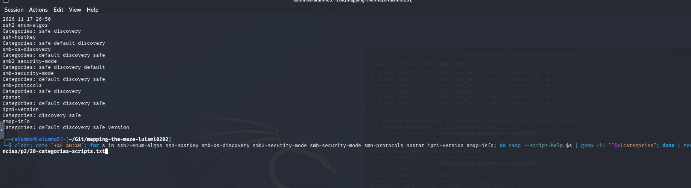

### Decisiones de la Parte 2 y por qué

| Decisión | Por qué | Dónde se ve |
|---|---|---|
| Scripts NSE de las categorías `default` **y** `safe` a la vez, excluyendo intrusive, exploit, dos, brute, malware, auth, broadcast y external | `default` son los scripts útiles y probados que nmap lanza por defecto; `safe` garantiza que no tumban el servicio ni modifican nada. Exigir las dos deja fuera lo agresivo. Las exclusiones cubren lo que prohíben las reglas (explotar, fuerza bruta, credenciales), lo que sale fuera del alcance (`broadcast`) y lo que envía datos a terceros (`external`) | `evidencias/p2/20-nse-*`, variable `$SAFE` en el cuaderno |
| Comprobar las categorías de cada script suelto antes de lanzarlo | Un script con nombre inocente puede ser `intrusive` o `auth`. Se mira primero y solo se usa si es seguro | `evidencias/p2/20-categorias-scripts.txt` |
| No usar `smb-os-discovery` aunque es `safe` | Para obtener sus datos abre una sesión anónima (nula) en SMB, y eso ya es acceder con credenciales vacías, que las reglas no permiten | «Limitaciones» |
| Leer banners con `nc -nv -w 3 ... </dev/null` | El servicio envía su saludo al conectar; con `</dev/null` no se le envía nada, así que solo se lee lo que publica. `-n` evita consultas DNS y `-w 3` corta a los 3 segundos | `evidencias/p2/22-ssh-banner-*`, `23-*` |
| Web: `curl -sk -I` (solo cabeceras), la portada y `/robots.txt` | Son peticiones normales que haría cualquier navegador. `-I` pide solo las cabeceras, donde suele ir la versión (así apareció `X-Jenkins: 2.441`). `-k` acepta el certificado autofirmado de la .5 sin validarlo. `robots.txt` es un fichero público que a veces revela rutas sin necesidad de fuerza bruta | `evidencias/p2/21-http-*` |
| `whatweb -a 1` | El nivel de agresividad 1 hace una sola petición por URL y solo analiza la respuesta; los niveles altos prueban rutas adicionales | `evidencias/p2/21-whatweb-*` |
| Certificado HTTPS con `openssl s_client` | Lee el certificado que el servidor entrega a cualquiera al iniciar la conexión: emisor, nombre y caducidad, sin autenticarse | `evidencias/p2/21-tls-cert-172.17.0.5-443.txt` |
| SSH: `ssh2-enum-algos` y `ssh-hostkey` | Solo leen la negociación inicial, que es pública. Los algoritmos y la revisión del paquete del banner se necesitan en la Parte 3 para descartar o confirmar CVE | `evidencias/p2/22-ssh-*` |
| SMB solo con negociación (`smb-protocols`, `smb2-security-mode`, `smb-security-mode`) y NetBIOS con `nbstat` y `nmblookup` | Informan de dialectos, firma y nombres sin abrir sesión. Listar recursos o usuarios (`smb-enum-*`, `smbclient -N`, `enum4linux`) exige sesión anónima | `evidencias/p2/24-*` |
| IPMI solo con `ipmi-version` | Da la versión y los métodos de autenticación. Pedir usuarios o hashes (`ipmi-dumphashes`) sería explotar el fallo de RAKP | `evidencias/p2/25-ipmi-172.17.0.10.*` |
| No visitar `/manager/status` (.4) ni `login.html` (.9), ni probar credenciales en ninguna consola | Son zonas de administración o de acceso: entrar o probar contraseñas, aunque sean las de fábrica, es acceder con autenticación | «Limitaciones» |
| Equipo delicado (.7): solo banner y dos scripts SSH, con `-T2 --max-retries 1` | Es el equipo que más fácil se cae. Lo mínimo para conocer su SSH, despacio y sin reintentos | `evidencias/p2/22-ssh-172.17.0.7.*` |
| Vigilar la .10 con `ping` durante la Parte 2 | Las consolas de gestión (IPMI) suelen ser frágiles ante el tráfico de escaneo | Fondo de las capturas p2 (516 enviados, 516 recibidos) |
| Buscar cuentas con `grep` en las evidencias y revisar a mano cada candidato | El `grep` encuentra todo lo que parece una cuenta, pero muchos resultados no lo son (textos de ejemplo, nombres de equipo, métodos de autenticación). La revisión manual los separa | «Cuentas de usuario descubiertas», `evidencias/p2/29-cuentas-candidatas.txt` |

### 172.17.0.3 - Servidor FTP y web
| Puerto/servicio | Qué expone sin autenticar | Cómo se obtuvo | Evidencia |
|---|---|---|---|
| 21/ftp | Saludo `220 (vsFTPd 2.3.4)`. **Hallazgo grave**: versión conocida por llevar una puerta trasera. Solo se leyó el banner, sin enviar datos; no se inició sesión ni se usó `ftp-vsftpd-backdoor`. Anotado y avisado al profesor | `nc -nv -w 3 172.17.0.3 21 </dev/null` | `evidencias/p2/23-ftp-banner-172.17.0.3.txt`, [captura](imagenes/p2-06-banner-ftp-activemq.png) |
| 80/http | Servidor `Apache/2.4.58 (Ubuntu)`; título «Apache2 Ubuntu Default Page: It works» (página por defecto, sin contenido propio) | `curl -sk -I`, `whatweb -a 1`, script NSE `http-title` | `evidencias/p2/21-http-cabeceras-172.17.0.3-80.txt`, `evidencias/p2/21-whatweb-172.17.0.3-80.txt`, [captura](imagenes/p2-03-http-172.17.0.3-80.png) |
| 80/http | Sin `robots.txt` (404) | `curl -sk /robots.txt` | `evidencias/p2/21-http-robots-172.17.0.3-80.txt`, [captura](imagenes/p2-03-http-172.17.0.3-80.png) |

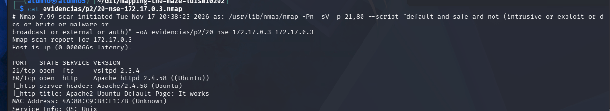

### 172.17.0.4 - Aplicación web Java (Tomcat)
| Puerto/servicio | Qué expone sin autenticar | Cómo se obtuvo | Evidencia |
|---|---|---|---|
| 22/ssh | Banner `SSH-2.0-OpenSSH_7.9p1 Debian-10+deb10u4` (Debian 10). Admite algoritmos antiguos: `diffie-hellman-group14-sha1`, clave de host `ssh-rsa` (SHA-1) y MAC `hmac-sha1`. Claves de host RSA 2048, ECDSA 256 y ED25519 256 | `nc -nv -w 3`, NSE `ssh2-enum-algos` y `ssh-hostkey` | `evidencias/p2/22-ssh-banner-172.17.0.4.txt`, `evidencias/p2/22-ssh-172.17.0.4.nmap`, [captura](imagenes/p2-05-ssh-172.17.0.4.png) |
| 8009/ajp13 | Conector AJP 1.3 de Tomcat expuesto en la red; métodos admitidos GET, HEAD, POST y OPTIONS. No envía saludo al conectar | NSE `ajp-methods` (dentro del filtro default y safe); `nc` | `evidencias/p2/20-nse-172.17.0.4.nmap`, `evidencias/p2/23-banner-sin-saludo.txt`, [captura](imagenes/p2-06-banner-sin-saludo.png) |
| 8080/http | Página por defecto de `Apache Tomcat/9.0.30` (versión en el título y en las páginas de error). La portada enlaza a `/manager/status` (no se visitó) | `curl`, `whatweb -a 1`, NSE `http-title` y `http-favicon` | `evidencias/p2/21-http-pistas-172.17.0.4-8080.txt`, `evidencias/p2/21-whatweb-172.17.0.4-8080.txt`, [captura](imagenes/p2-03-http-172.17.0.4-8080.png) |
| 8080/http | Sin `robots.txt` (404 de Tomcat, que vuelve a mostrar la versión 9.0.30) | `curl -sk /robots.txt` | `evidencias/p2/21-http-robots-172.17.0.4-8080.txt`, [captura](imagenes/p2-03-http-172.17.0.4-8080.png) |

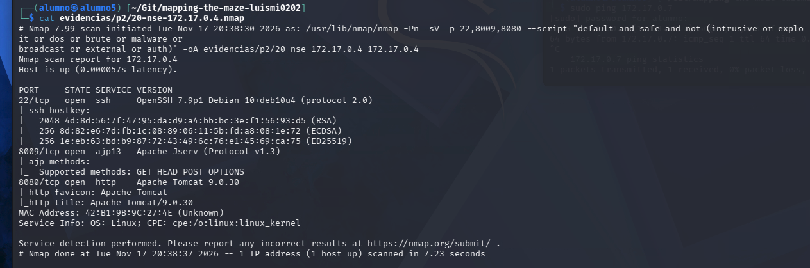

### 172.17.0.5 - Portal de clientes
| Puerto/servicio | Qué expone sin autenticar | Cómo se obtuvo | Evidencia |
|---|---|---|---|
| 80/http | Servidor `Apache/2.4.59 (Debian)`; página por defecto «Apache2 Debian Default Page» | `curl -sk -I`, `whatweb -a 1` | `evidencias/p2/21-http-cabeceras-172.17.0.5-80.txt`, `evidencias/p2/21-whatweb-172.17.0.5-80.txt`, [captura](imagenes/p2-03-http-172.17.0.5-80.png) |
| 80/http | Sin `robots.txt` (404) | `curl -sk /robots.txt` | `evidencias/p2/21-http-robots-172.17.0.5-80.txt`, [captura](imagenes/p2-03-http-172.17.0.5-80.png) |
| 443/https | Servidor `Apache/2.4.59 (Debian)`; web pública con título «DockerLabs \| Plantilla gratuita Bootstrap 4.3.x», jQuery 3.4.1, metaetiqueta `author` = `Devcrud` y correo `info@dockerlabs.lab` | `curl`, `whatweb -a 1` | `evidencias/p2/21-http-pistas-172.17.0.5-443.txt`, `evidencias/p2/21-whatweb-172.17.0.5-443.txt`, [captura](imagenes/p2-03-http-172.17.0.5-443.png) |
| 443/https | Sin `robots.txt` (404) | `curl -sk /robots.txt` | `evidencias/p2/21-http-robots-172.17.0.5-443.txt`, [captura](imagenes/p2-03-http-172.17.0.5-443.png) |
| 443/https | Certificado CN=example.com, O=Your Organization, OU=Your Unit (San Francisco, California, US), emitido por sí mismo (autofirmado), válido del 2024-04-17 al **2025-04-17: caducado** | `openssl s_client` + `openssl x509` | `evidencias/p2/21-tls-cert-172.17.0.5-443.txt`, [captura](imagenes/p2-04-tls-172.17.0.5.png) |

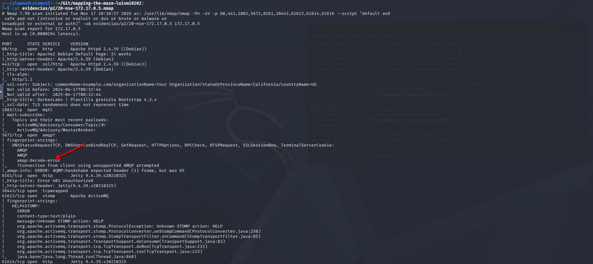

### 172.17.0.5 - Mensajería con operadores
| Puerto/servicio | Qué expone sin autenticar | Cómo se obtuvo | Evidencia |
|---|---|---|---|
| 61616/OpenWire | Al conectar, el broker envía su `WireFormatInfo`: ProviderName `ActiveMQ`, PlatformDetails `Java`, **ProviderVersion `5.15.15`**, con StackTraceEnabled, CacheEnabled y TightEncodingEnabled | `nc -nv -w 3 172.17.0.5 61616 </dev/null` | `evidencias/p2/23-banner-172.17.0.5-61616.txt`, [captura](imagenes/p2-06-banner-ftp-activemq.png) |
| 61613/stomp | Ante una orden desconocida responde con un error y la traza Java completa (`org.apache.activemq.transport.stomp...`). No envía saludo al conectar | Sonda de versión de nmap (`-sV`); `nc` | `evidencias/p2/20-nse-172.17.0.5.nmap`, `evidencias/p2/23-banner-sin-saludo.txt`, [captura](imagenes/p2-06-banner-sin-saludo.png) |
| 5672/amqp | Responde `AMQP` y el error `amqp:decode-error ... unsupported AMQP`: habla AMQP 1.0. `amqp-info` falló (`handshake expected header (1) frame, but was 65`) porque el script solo entiende AMQP 0-9-1 | NSE `amqp-info`; `nc` | `evidencias/p2/26-amqp-172.17.0.5.nmap`, `evidencias/p2/20-nse-172.17.0.5.nmap`, [captura](imagenes/p2-09-amqp-172.17.0.5.png) |
| 1883/mqtt | El script `mqtt-subscribe`, lanzado automáticamente por nmap al usar `-sV` (categoría `version`; no se pidió), obtuvo los topics de aviso del broker (`ActiveMQ/Advisory/Consumer/Topic/#`, `ActiveMQ/Advisory/MasterBroker`), sin contenido. No envía saludo al conectar | Script de versión de nmap ejecutado con `-sV`; `nc` | `evidencias/p2/20-nse-172.17.0.5.nmap`, `evidencias/p2/23-banner-sin-saludo.txt`, [captura](imagenes/p2-01-nse-172.17.0.5.png), [categorías](imagenes/p2-11-categorias-mqtt-subscribe.png) |
| 8161/http | Consola web de ActiveMQ en `Jetty(9.4.39.v20210325)`: responde `401 Unauthorized` con `WWW-Authenticate: basic realm="ActiveMQRealm"`; también `robots.txt` pide autenticación. No se probaron credenciales | `curl -sk -I`, `whatweb -a 1` | `evidencias/p2/21-http-cabeceras-172.17.0.5-8161.txt`, `evidencias/p2/21-whatweb-172.17.0.5-8161.txt`, [captura](imagenes/p2-03-http-172.17.0.5-8161.png) |
| 61614/http | WebSocket de ActiveMQ en `Jetty(9.4.39.v20210325)`: responde 200 con cuerpo vacío; admite el método `TRACE` | `curl -sk -I`, `whatweb -a 1`, NSE `http-methods` | `evidencias/p2/21-http-cabeceras-172.17.0.5-61614.txt`, `evidencias/p2/20-nse-172.17.0.5.nmap`, [captura](imagenes/p2-03-http-172.17.0.5-61614.png) |
| 38443/tcp | Acepta la conexión pero no envía nada (`tcpwrapped`). Servicio no identificado | `nc -nv -w 3 172.17.0.5 38443 </dev/null` | `evidencias/p2/23-banner-172.17.0.5-38443.txt`, [captura](imagenes/p2-06-banner-ftp-activemq.png) |

### 172.17.0.6 - Servidor Jenkins
| Puerto/servicio | Qué expone sin autenticar | Cómo se obtuvo | Evidencia |
|---|---|---|---|
| 22/ssh | Banner `SSH-2.0-OpenSSH_9.2p1 Debian-2+deb12u2` (Debian 12). Admite `hmac-sha1`; ya ofrece intercambio de claves poscuántico (`sntrup761x25519-sha512@openssh.com`). Claves de host ECDSA y ED25519 | `nc -nv -w 3`, NSE `ssh2-enum-algos` y `ssh-hostkey` | `evidencias/p2/22-ssh-banner-172.17.0.6.txt`, `evidencias/p2/22-ssh-172.17.0.6.nmap`, [captura](imagenes/p2-05-ssh-172.17.0.6.png) |
| 8080/http | Las cabeceras revelan **Jenkins 2.441** (`X-Jenkins: 2.441`, `X-Hudson: 1.395`) sobre `Jetty(10.0.18)`. La portada da 403 y redirige a `/login?from=%2F` («Sign in [Jenkins]») | `curl -sk -I`, `whatweb -a 1` | `evidencias/p2/21-http-cabeceras-172.17.0.6-8080.txt`, `evidencias/p2/21-whatweb-172.17.0.6-8080.txt`, [captura](imagenes/p2-03-http-172.17.0.6-8080.png) |
| 8080/http | `robots.txt` con `Disallow: /` y el comentario «we don't want robots to click "build" links» (el que trae Jenkins por defecto) | `curl -sk /robots.txt`, NSE `http-robots.txt` | `evidencias/p2/21-http-robots-172.17.0.6-8080.txt`, [captura](imagenes/p2-03-http-172.17.0.6-8080.png) |

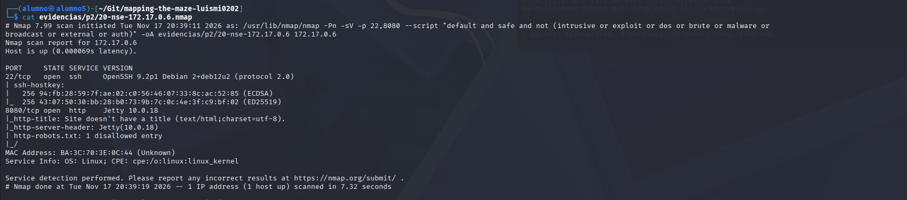

### 172.17.0.7 - Equipo antiguo y delicado
| Puerto/servicio | Qué expone sin autenticar | Cómo se obtuvo | Evidencia |
|---|---|---|---|
| 22/ssh | Banner `SSH-2.0-OpenSSH_7.7`, sin paquete de distribución | `nc -nv -w 3 172.17.0.7 22 </dev/null` | `evidencias/p2/22-ssh-banner-172.17.0.7.txt`, [captura](imagenes/p2-05-ssh-172.17.0.7.png) |
| 22/ssh | Admite algoritmos antiguos: `diffie-hellman-group14-sha1`, clave de host `ssh-rsa` (SHA-1) y MAC `hmac-sha1`. Claves de host RSA 2048, ECDSA 256 y ED25519 256 | NSE `ssh2-enum-algos` y `ssh-hostkey` con `-T2 --max-retries 1` | `evidencias/p2/22-ssh-172.17.0.7.nmap`, `evidencias/p2/20-nse-172.17.0.7.nmap`, [captura](imagenes/p2-05-ssh-172.17.0.7.png) |

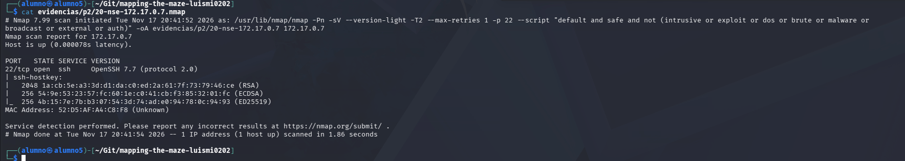

### 172.17.0.8 - Servidor de ficheros (Samba)
| Puerto/servicio | Qué expone sin autenticar | Cómo se obtuvo | Evidencia |
|---|---|---|---|
| 22/ssh | Banner `SSH-2.0-OpenSSH_9.6p1 Ubuntu-3ubuntu13.5` (Ubuntu 24.04). Admite `hmac-sha1`; ofrece `sntrup761x25519-sha512@openssh.com`. Claves de host ECDSA y ED25519 | `nc -nv -w 3`, NSE `ssh2-enum-algos` y `ssh-hostkey` | `evidencias/p2/22-ssh-banner-172.17.0.8.txt`, `evidencias/p2/22-ssh-172.17.0.8.nmap`, [captura](imagenes/p2-05-ssh-172.17.0.8.png) |
| 80/http | Servidor `Apache/2.4.58 (Ubuntu)`; página «Login» con formulario de correo y contraseña (el campo de correo trae el texto de ejemplo `ejemplo@correo.com`) y enlace de registro | `curl -sk -I`, `curl` (pistas), `whatweb -a 1` | `evidencias/p2/21-http-cabeceras-172.17.0.8-80.txt`, `evidencias/p2/21-http-pistas-172.17.0.8-80.txt`, [captura](imagenes/p2-03-http-172.17.0.8-80.png) |
| 80/http | Sin `robots.txt` (404) | `curl -sk /robots.txt` | `evidencias/p2/21-http-robots-172.17.0.8-80.txt`, [captura](imagenes/p2-03-http-172.17.0.8-80.png) |
| 139,445/smb | Dialectos SMB 2.0.2, 2.1, 3.0, 3.0.2 y 3.1.1 (sin SMBv1). **Firma de mensajes habilitada pero no obligatoria** | NSE `smb-protocols`, `smb2-security-mode`, `smb-security-mode` (solo negociación, sin sesión) | `evidencias/p2/24-smb-172.17.0.8.nmap`, [captura](imagenes/p2-07-smb-172.17.0.8.png) |
| 445/smb | Hora del servidor (2026-11-17T20:39:31) | NSE `smb2-time` (dentro del filtro default y safe) | `evidencias/p2/20-nse-172.17.0.8.nmap`, [captura](imagenes/p2-01-nse-172.17.0.8.png) |

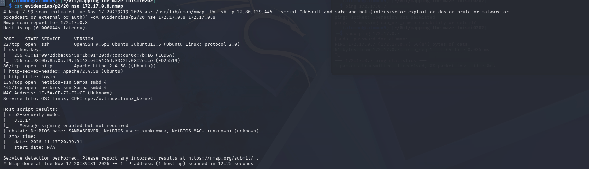

### 172.17.0.9 - Servidor web en desarrollo
| Puerto/servicio | Qué expone sin autenticar | Cómo se obtuvo | Evidencia |
|---|---|---|---|
| 22/ssh | Banner `SSH-2.0-OpenSSH_9.2p1 Debian-2+deb12u10` (Debian 12). Admite `hmac-sha1`; ofrece `sntrup761x25519-sha512`. Claves de host ECDSA y ED25519 | `nc -nv -w 3`, NSE `ssh2-enum-algos` y `ssh-hostkey` | `evidencias/p2/22-ssh-banner-172.17.0.9.txt`, `evidencias/p2/22-ssh-172.17.0.9.nmap`, [captura](imagenes/p2-05-ssh-172.17.0.9.png) |
| 80/http | Servidor `Apache/2.4.68 (Debian)`; página «test page» con el texto «Under Development» y un enlace a `login.html` (no se visitó) | `curl -sk -I`, `curl` (pistas), `whatweb -a 1` | `evidencias/p2/21-http-cabeceras-172.17.0.9-80.txt`, `evidencias/p2/21-http-pistas-172.17.0.9-80.txt`, [captura](imagenes/p2-03-http-172.17.0.9-80.png) |
| 80/http | Sin `robots.txt` (404) | `curl -sk /robots.txt` | `evidencias/p2/21-http-robots-172.17.0.9-80.txt`, [captura](imagenes/p2-03-http-172.17.0.9-80.png) |

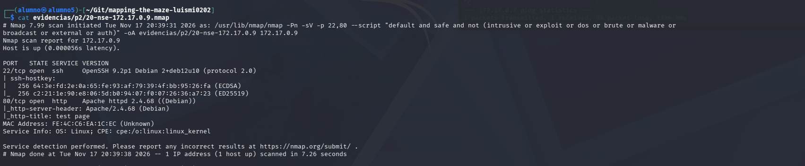

### 172.17.0.10 - Consola de gestión de servidores
| Puerto/servicio | Qué expone sin autenticar | Cómo se obtuvo | Evidencia |
|---|---|---|---|
| 80/http | Servidor `SimpleHTTP/0.6 Python/3.11.2`; página «CTG · IPMI bajo exposición», que explica IPMI, BMC, el puerto UDP 623 y Serial Over LAN. Última modificación: 2026-09-25 | `curl -sk -I`, `curl` (pistas), `whatweb -a 1` | `evidencias/p2/21-http-cabeceras-172.17.0.10-80.txt`, `evidencias/p2/21-http-pistas-172.17.0.10-80.txt`, [captura](imagenes/p2-03-http-172.17.0.10-80.png) |
| 80/http | Sin `robots.txt` (404) | `curl -sk /robots.txt` | `evidencias/p2/21-http-robots-172.17.0.10-80.txt`, [captura](imagenes/p2-03-http-172.17.0.10-80.png) |
| 623/udp | IPMI 2.0 (ver «Servicios UDP») | NSE `ipmi-version` | `evidencias/p2/25-ipmi-172.17.0.10.nmap`, [captura](imagenes/p2-08-udp-ipmi-172.17.0.10.png) |

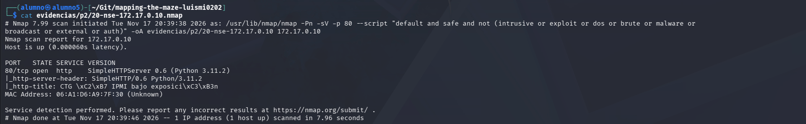

### Servicios UDP
| IP:puerto | Servicio | Qué expone | Evidencia |
|---|---|---|---|
| 172.17.0.8:137/udp | NetBIOS (Samba nmbd) | Nombre de equipo `SAMBASERVER` (sufijos `<00>`, `<03>` y `<20>`), grupo de trabajo `ESEEMEB.DL` (`<00>`, `<1d>` y `<1e>`; en la Parte 1 nmap lo mostró recortado como «DL»), y `__MSBROWSE__`: es el explorador maestro del grupo. NetBIOS user `<unknown>` | `evidencias/p2/24-nbstat-172.17.0.8.nmap`, `evidencias/p2/24-nmblookup-172.17.0.8.txt`, [captura](imagenes/p2-07-smb-172.17.0.8.png) |
| 172.17.0.10:623/udp | IPMI (RMCP) | Versión **IPMI-2.0**, niveles 1.5 y 2.0. Métodos de autenticación anunciados: `password`, `md5`, `md2` y **`null`**; PassAuth `auth_msg`, `auth_user`, `non_null_user`. No anuncia nombres de usuario | `evidencias/p2/25-ipmi-172.17.0.10.nmap`, [captura](imagenes/p2-08-udp-ipmi-172.17.0.10.png) |

### Cuentas de usuario descubiertas
| Cuenta | Equipo y servicio | Cómo se obtuvo | Evidencia |
|---|---|---|---|
| `info@dockerlabs.lab` | 172.17.0.5, web HTTPS (443/tcp) | Correo publicado en la portada, detectado por `whatweb -a 1` | `evidencias/p2/21-whatweb-172.17.0.5-443.txt`, [captura](imagenes/p2-03-http-172.17.0.5-443.png) |
| `Devcrud` (autor) | 172.17.0.5, web HTTPS (443/tcp) | Metaetiqueta `<meta name="author">` de la portada. Es el autor de la plantilla Bootstrap, no necesariamente una persona de la empresa | `evidencias/p2/21-http-pistas-172.17.0.5-443.txt`, [captura](imagenes/p2-03-http-172.17.0.5-443.png) |

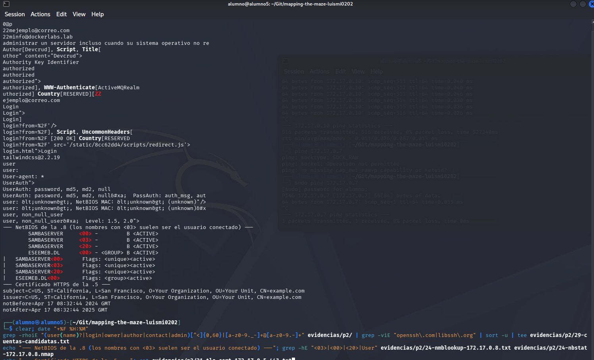

Ninguna cuenta se ha usado ni probado; solo se documenta que el servicio la revela.

Candidatos de `evidencias/p2/29-cuentas-candidatas.txt` que se revisaron y **no** son cuentas:
- `ejemplo@correo.com` (172.17.0.8:80): es el texto de ejemplo (`placeholder`) del campo de correo del formulario de login, no una cuenta real.
- `SAMBASERVER<03>` (172.17.0.8, nbstat y nmblookup): el `<03>` lleva el nombre del propio equipo, no el de un usuario. No aparece ningún otro nombre con `<03>` y nbstat devuelve `NetBIOS user: <unknown>`.
- `ESEEMEB.DL`: es el grupo de trabajo, no una cuenta.
- Certificado de 172.17.0.5:443: solo datos genéricos (`example.com`, «Your Organization»), sin nombres ni correos.
- IPMI (172.17.0.10): `ipmi-version` no anuncia usuarios; `UserAuth: ... null` y `non_null_user` son métodos de autenticación, no cuentas.
- Algoritmos SSH con `@openssh.com` o `@libssh.org`: se filtraron en el propio `grep`.
- Palabras genéricas (`user`, `Login`, `authorized`, `UserAuth`): no son cuentas.

### Limitaciones
- No se probaron la sesión nula de SMB, el FTP anónimo ni communities SNMP: serían accesos con
  credenciales anónimas o por defecto, que las reglas de compromiso no permiten. En SMB solo se
  hizo negociación (`smb-protocols`, `smb2-security-mode`, `smb-security-mode`), `nbstat` y
  `nmblookup`; no se usaron `smb-os-discovery` (inicia sesión anónima), `smb-enum-users`,
  `smb-enum-shares`, `smbclient -N` ni `enum4linux`. Por eso no se conocen los recursos
  compartidos ni los usuarios de Samba.
- Los puertos UDP marcados `open|filtered` no respondieron y no se pudieron confirmar. No había
  SNMP, NTP ni DNS abiertos, así que no se lanzaron `snmp-info`, `ntp-info` ni `dns-nsid`.
- El equipo 172.17.0.7 se enumeró al mínimo por ser delicado: solo banner, `ssh2-enum-algos` y
  `ssh-hostkey` con `-T2 --max-retries 1`.
- 172.17.0.5:38443: no devolvió banner ni información sin autenticar (acepta la conexión y la cierra).
- 172.17.0.5:1883 (MQTT), 5672 (AMQP), 61613 (STOMP) y 172.17.0.4:8009 (AJP): no envían saludo al
  conectar con `nc`.
- 172.17.0.5:5672: `amqp-info` no pudo leer las propiedades del broker porque el servicio habla
  AMQP 1.0 y el script, AMQP 0-9-1. No se usaron clientes de mensajería para sacar más datos.
- 172.17.0.5:1883: el script `mqtt-subscribe` no estaba pedido (no es de la categoría default):
  nmap lo lanzó por su cuenta al usar `-sV`, por ser de la categoría `version`. Ocurrió en el
  escaneo NSE de esta parte y otra vez en el de `vulners` de la Parte 3; nunca se lanzó aparte.
  Solo devolvió nombres de topics de aviso, sin contenido. El broker aceptó la conexión sin credenciales: servicio expuesto, pendiente
  de comprobar en la siguiente fase si requiere autenticación.
- 172.17.0.5:8161 (consola de ActiveMQ), 172.17.0.6:8080 (Jenkins) y los formularios de login de
  172.17.0.8 y 172.17.0.9 piden autenticación: no se probaron credenciales, ni las de por defecto.
  Tampoco se visitaron `/manager/status` (172.17.0.4) ni `login.html` (172.17.0.9).
- 172.17.0.10:623: no se pidieron usuarios ni hashes a IPMI (eso es atacar el protocolo); solo
  versión y métodos de autenticación.
- No se descubrieron rutas web por fuerza bruta; solo se revisó lo que el servidor publica.
