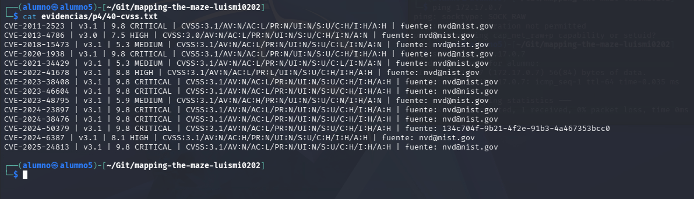
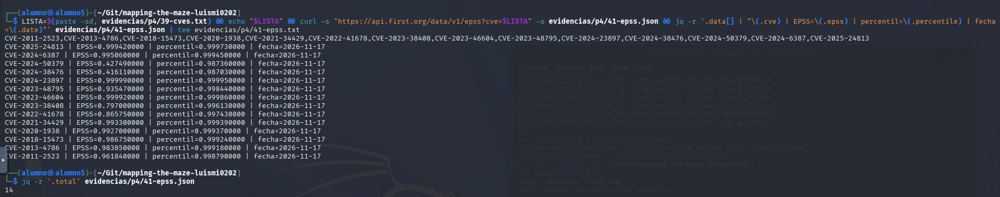
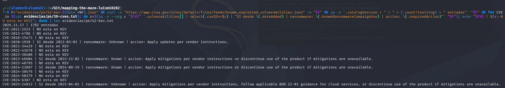

# Registro de vulnerabilidades - Gadir Logística, S.L.

**Alcance:** 172.17.0.0/24
**Autor:** Luis Miguel Gomila Domínguez
**Fecha:** 2026-11-18
**Criterio de evaluación:** RA3.b, inventario de potenciales vulnerabilidades.

## Método
1. Versiones obtenidas en las Partes 1 y 2 (nmap `-sV`, banners, cabeceras HTTP), reunidas en
   `evidencias/p3/30-versiones.txt`. Jenkins 2.441 (172.17.0.6) e IPMI 2.0 (172.17.0.10) se
   añadieron a mano a esa lista en una revisión posterior: nmap `-sV` solo veía «Jetty 10.0.18» en
   el 8080 de la .6, y `vulners` solo revisa puertos TCP, así que ninguno de los dos salía.
2. Candidatos con el script `vulners` de nmap (solo consulta) y búsqueda en Exploit-DB con
   `searchsploit` (solo listado, sin descargar ni ejecutar nada). Para la 172.17.0.7, con la
   versión ya conocida, la consulta se hizo directamente a la API de NVD.
3. Verificación manual de cada candidato en NVD (rango de versiones afectadas, campo
   `cpeMatch`) y en el seguimiento de seguridad de la distribución (Debian o Ubuntu), para
   detectar parches aplicados sin cambio de versión (backports).
4. Para cada candidato se responden cuatro preguntas: si la versión entra en el rango, si la
   distribución ya lo ha parcheado, si la identificación del servicio es fiable y si el fallo
   depende de una configuración concreta.
5. Descarte de los falsos positivos, documentado al final de este registro.

### Decisiones de las Partes 3 y 4 y por qué

| Decisión | Por qué |
|---|---|
| Partir solo de versiones observadas en las Partes 1 y 2, reunidas en `30-versiones.txt` | Un CVE solo tiene sentido si la versión se ha visto en la red. Las versiones confirmadas por el propio servicio (banner de vsftpd, `ProviderVersion` de ActiveMQ, cabecera `X-Jenkins`) pesan más que la deducción de nmap |
| `vulners` con `--script-args mincvss=5.0` | Se centra en los fallos de gravedad media o superior, los que pueden entrar en las pocas correcciones del trimestre. Los CVE con CVSS inferior a 5 no se han revisado: queda como limitación |
| No lanzar `vulners` contra 172.17.0.7; consultar sus CVE en la API de NVD | `vulners` necesita un `-sV` nuevo contra el equipo, y la versión (OpenSSH 7.7) ya se conocía. Consultar NVD no envía ningún paquete al equipo delicado |
| Añadir a mano Jenkins 2.441 e IPMI 2.0 | `vulners` no podía verlos: nmap identificaba el 8080 de la .6 solo como «Jetty», y `vulners` solo revisa puertos TCP, mientras que IPMI es 623/udp. Sin la revisión manual faltarían dos hallazgos, uno de ellos el segundo en prioridad |
| `searchsploit` solo para listar, sin abrir, copiar ni ejecutar nada | Saber que existe código público es un dato para la prioridad. Usarlo sería explotar, y está prohibido |
| Comprobar cada candidato en NVD (`cpeMatch`) y en los trackers de Debian y Ubuntu | Las herramientas comparan solo el número de versión. Debian y Ubuntu corrigen fallos sin cambiar ese número (backport), así que hace falta la revisión del paquete para saber si el equipo está parcheado |
| Separar «sospecha fundada» (V-01 a V-08) de «pendientes de confirmar» (V-09 a V-12) | Los segundos dependen de algo que no se puede ver sin credenciales o sin pruebas intrusivas (configuración, autenticación, fabricante). Se mantienen, pero con menos peso |
| CWE: la que asigna NVD; si NVD no da una concreta, una elegida y señalada como propia | Así cada CWE se puede rastrear hasta su fuente. Solo pasa en V-03, donde NVD pone «NVD-CWE-Other» y se eligió CWE-284 (Tomcat confía en las conexiones AJP más que en las HTTP) |
| ATT&CK: si el fallo se aprovecha atacando un servicio, T1190 para la .5 y T1210 para los equipos internos; si no, la técnica que describe el ataque | T1190 (Exploit Public-Facing Application) es para lo que da la cara al exterior: la .5 tiene el portal de clientes y la mensajería con operadores externos. El resto de equipos solo se alcanzan desde la red interna, que corresponde a T1210 (Exploitation of Remote Services). Los fallos que no consisten en atacar un servicio llevan la técnica de lo que hace el atacante: T1087 (descubrir cuentas, V-06), T1557 (ponerse en medio, V-07) y T1110.002 con T1078 (descifrar y usar contraseñas, V-12). Se añaden técnicas complementarias cuando describen el efecto (T1005 lectura de ficheros, T1078 cuentas válidas, T1195.002 origen en la cadena de suministro) |
| CVSS: puntuación de NVD, preferentemente la 3.1 | NVD es la fuente de referencia del CVE. Usar la misma versión de CVSS en todos los hallazgos permite compararlos; solo CVE-2013-4786 no tiene 3.1 y se usa su 3.0 |
| Consultar también CVSS, EPSS y KEV de los dos CVE descartados | Para documentar sus datos. Siguen descartados y no entran en el orden |
| Ordenar con KEV y EPSS antes que con CVSS | Lo pide el enunciado: un fallo que ya se explota de verdad es más urgente que otro con más nota pero sin ataques conocidos. El método completo está en «Orden de prioridad» |

Ningún hallazgo se ha confirmado explotándolo. Todos son vulnerabilidades **potenciales**: se
sospecha que existen por la versión observada, pero no se ha demostrado.

### Nota de transparencia
Al lanzar `nmap -sV --script vulners` contra la 172.17.0.5, nmap ejecutó además, de forma
automática, los scripts de la categoría `version` asociados a los puertos detectados
(`mqtt-subscribe` en el 1883 y `amqp-info` en el 5672). No se pidieron expresamente.
`mqtt-subscribe` devolvió dos temas de aviso de ActiveMQ (`ActiveMQ/Advisory/Consumer/Topic/#` y
`ActiveMQ/Advisory/MasterBroker`) sin contenido, y `amqp-info` terminó con error de negociación
(`AQMP:handshake expected header (1) frame, but was 65`), igual que en la Parte 2. No se han repetido. Queda registrado en `evidencias/p3/31-vulners-172.17.0.5.nmap`.

## Orden de prioridad

**Autor de la priorización:** Luis Miguel Gomila Domínguez
**Fecha de consulta de las fuentes:** 2026-11-18
**Fuentes:** NVD (CVSS y CWE), FIRST EPSS, CISA KEV.

### Método
No se ordena solo por CVSS. Los criterios, de mayor a menor peso, son:
1. Explotación conocida: estar en el catálogo KEV de CISA, y sobre todo con uso en ransomware.
2. Probabilidad de explotación: EPSS igual o superior a 0,1 o percentil igual o superior a 0,95.
3. Gravedad técnica: puntuación CVSS base.
4. Importancia del equipo para el negocio: consola de gestión, mensajería con operadores
   (facturación), portal de clientes, equipo antiguo y servidor de pruebas.
5. Solidez de la evidencia: versión clara y sin parche de la distribución.

Cómo se aplican:
- **KEV:** los CVE del catálogo van por delante de todos los demás. Entre ellos, primero los que
  tienen `ransomware: Known`.
- **EPSS:** en esta consulta los 12 CVE del registro superan el umbral (el más bajo es 0,416 y todos
  tienen percentil igual o superior a 0,987). Como umbral no separa unos hallazgos de otros, así
  que el orden fuera de KEV lo decide el tramo de CVSS.
- **CVSS por tramos:** crítico (9 a 10), alto (7 a 8,9) y medio (4 a 6,9). Entre tramos manda el
  tramo. Dentro de un mismo tramo se aplican, por este orden:
  1. **Excepción de EPSS y evidencia:** si un CVE tiene más CVSS que otro, pero el otro tiene más
     EPSS y una evidencia igual o más sólida, va primero el otro. Por eso V-12 va antes que V-09,
     V-04 va antes que V-09, V-05 va antes que V-07 y V-06 va antes que V-07.
  2. **Importancia del equipo.** Por eso V-12 va antes que V-04.
  3. **Solidez de la evidencia**, si siguen empatados.
- **Única excepción entre tramos:** un hallazgo que depende de una configuración de la que no hay
  ningún indicio baja por debajo de los demás. Es el caso de V-11: necesita que Apache haga de
  proxy, no hay evidencia de que lo haga, y tiene el EPSS más bajo del registro con diferencia
  (0,416). Por eso queda en el último puesto pese a su CVSS 9,8.
- **Importancia del equipo:** consola de gestión (172.17.0.10, IPMI), mensajería con operadores
  ligada a la facturación (172.17.0.5, ActiveMQ), portal de clientes (172.17.0.5, web), equipo
  antiguo (172.17.0.7) y servidor de pruebas (172.17.0.9). La .3, la .4 y la .6 no aparecen en el
  correo del cliente y se tratan después de estos.
- **Solidez de la evidencia:** una ficha «pendiente de confirmar» (depende de la configuración o
  de credenciales) pesa menos que una con sospecha fundada.

Casos en los que el orden no sigue al CVSS:
- V-08 (Jenkins) va antes que V-01 (vsftpd), aunque los dos tienen CVSS 9,8: V-08 está en KEV con
  uso en ransomware y EPSS 0,99999, y V-01 no figura en KEV.
- V-10 (PUT parcial en Tomcat) va antes que V-01 aunque depende de una configuración no estándar:
  está en KEV y el criterio 1 pesa más que la solidez de la evidencia.
- V-12 (IPMI, CVSS 7,5) va antes que V-04 (regreSSHion, CVSS 8,1): los dos están en el tramo alto,
  y la .10 es la consola de gestión, el equipo más importante para el negocio.
- V-04 (regreSSHion, CVSS 8,1) va antes que V-09 (Jolokia, CVSS 8,8). Los dos están en el tramo
  alto. V-04 tiene más EPSS (0,99506 frente a 0,86575), no necesita credenciales y su evidencia es
  sólida (revisión del paquete anterior al parche). V-09 exige estar autenticado y está pendiente
  de confirmar. Además, V-09 se corrige con la misma actualización de ActiveMQ que V-02
  (prioridad 1).

| Prioridad | ID | Equipo y servicio | CVE | CVSS | EPSS | KEV | Por qué va en este puesto |
|---|---|---|---|---|---|---|---|
| 1 | V-02 | 172.17.0.5, 61616/tcp, ActiveMQ 5.15.15 | CVE-2023-46604 | 9.8 | 0.99992 | Sí, ransomware | En KEV con uso en ransomware, ejecución remota sin credenciales y en la mensajería con operadores, ligada a la facturación |
| 2 | V-08 | 172.17.0.6, 8080/tcp, Jenkins 2.441 | CVE-2024-23897 | 9.8 | 0.99999 | Sí, ransomware | Mismo nivel que V-02 (KEV con ransomware, sin credenciales, EPSS prácticamente igual); va detrás porque la .6 no figura entre los equipos críticos del cliente |
| 3 | V-03 | 172.17.0.4, 8009/tcp, Tomcat 9.0.30 (AJP) | CVE-2020-1938 | 9.8 | 0.99270 | Sí | En KEV (ransomware desconocido) y la condición necesaria, el AJP expuesto, sí se observa |
| 4 | V-10 | 172.17.0.4, 8080/tcp, Tomcat 9.0.30 | CVE-2025-24813 | 9.8 | 0.99942 | Sí | En KEV, con EPSS algo mayor que V-03, pero requiere la escritura activada, que no es la configuración por defecto: evidencia más débil |
| 5 | V-01 | 172.17.0.3, 21/tcp, vsftpd 2.3.4 | CVE-2011-2523 | 9.8 | 0.96184 | No | El primero fuera de KEV: CVSS crítico, sin credenciales y versión exacta confirmada por banner. Ya comunicado al profesor |
| 6 | V-12 | 172.17.0.10, 623/udp, IPMI 2.0 | CVE-2013-4786 | 7.5 | 0.98385 | No | Primero del tramo alto: la .10 es la consola de gestión, el equipo más importante para el negocio, y tiene el EPSS más alto del tramo junto a V-04. Pendiente de identificar el fabricante |
| 7 | V-04 | 172.17.0.6, 22/tcp, OpenSSH 9.2p1 Debian 2+deb12u2 | CVE-2024-6387 | 8.1 | 0.99506 | No | Tramo alto, sin credenciales, con evidencia sólida (revisión anterior al parche de Debian) y más EPSS que V-09. El ataque es de complejidad alta y el equipo no figura entre los críticos |
| 8 | V-09 | 172.17.0.5, 8161/tcp, consola de ActiveMQ 5.15.15 | CVE-2022-41678 | 8.8 | 0.86575 | No | Tramo alto y en la mensajería ligada a la facturación, pero exige estar autenticado, está pendiente de confirmar y tiene el EPSS más bajo del tramo. Se corrige con la misma actualización que V-02 |
| 9 | V-05 | 172.17.0.5, 8161 y 61614/tcp, Jetty 9.4.39 | CVE-2021-34429 | 5.3 | 0.99330 | No | Primero del tramo medio: está en el equipo de mensajería y portal, y tiene el EPSS más alto del tramo |
| 10 | V-06 | 172.17.0.7, 22/tcp, OpenSSH 7.7 | CVE-2018-15473 | 5.3 | 0.98675 | No | Equipo antiguo. Va antes que V-07 aunque tiene menos CVSS: más EPSS, no necesita posición de intermediario y `searchsploit` lista código público |
| 11 | V-07 | 172.17.0.7, 22/tcp, OpenSSH 7.7 | CVE-2023-48795 | 5.9 | 0.93547 | No | Equipo antiguo; exige que el atacante esté en medio de la comunicación |
| 12 | V-11 | 172.17.0.3, .5 y .8, 80/tcp (y 443 en la .5), Apache httpd 2.4.58/2.4.59 | CVE-2024-38476 | 9.8 | 0.41611 | No | Solo iría más arriba por el CVSS: tiene el EPSS más bajo del registro con diferencia, solo aplica si Apache hace de proxy (sin evidencia) y en la .3 y la .8 no se conoce la revisión del paquete |

### Comprobación del orden
Para cada fila, por qué va antes que la siguiente (y no solo por tener más CVSS):
- 1 antes que 2: los dos en KEV con ransomware y EPSS casi idéntico; decide el equipo (mensajería
  ligada a la facturación frente a un equipo no crítico).
- 2 antes que 3: ransomware Known frente a Unknown.
- 3 antes que 4: los dos en KEV; V-10 tiene algo más de EPSS, pero depende de una configuración no
  estándar y V-03 tiene su condición observada.
- 4 antes que 5: KEV frente a no KEV.
- 5 antes que 6: tramo crítico frente a alto y evidencia más sólida (versión exacta frente a
  fabricante desconocido). V-12 tiene algo más de EPSS (0,98385 frente a 0,96184), pero ambos
  están en el percentil 0,998 o superior y la diferencia no compensa.
- 6 antes que 7: los dos en el tramo alto y sin que la excepción de EPSS se aplique (V-04 tiene
  más CVSS y también más EPSS); decide la importancia del equipo (consola de gestión frente a un
  equipo no crítico).
- 7 antes que 8: los dos en el tramo alto. V-09 solo ganaría por CVSS; V-04 tiene más EPSS
  (0,995 frente a 0,866), no necesita credenciales y su evidencia es más sólida (sospecha fundada
  frente a pendiente de confirmar). La excepción de EPSS y evidencia pesa más que la importancia
  del equipo.
- 8 antes que 9: tramo alto frente a medio. Entre tramos manda el tramo, aunque V-05 tenga más EPSS.
- 9 antes que 10: mismo CVSS (5,3); decide el equipo (mensajería y portal frente al equipo
  antiguo), y además tiene más EPSS.
- 10 antes que 11: más EPSS, sin posición de intermediario y con código público listado.
- 11 antes que 12: V-11 solo ganaría por CVSS; V-07 tiene más EPSS (0,935 frente a 0,416) y
  versión confirmada sin condiciones de configuración.

### Datos no disponibles
- Todos los CVE del registro tienen puntuación propia de NVD. CVE-2013-4786 (V-12) solo tiene
  CVSS 3.0 en NVD, no 3.1; se usa esa.
- Todos tienen EPSS publicado. Los valores son del 2026-11-17, la última fecha que devolvía FIRST
  al consultar el 2026-11-18.
- KEV: catálogo versión 2026.11.17, con 1782 entradas, descargado el 2026-11-18.
- También se consultaron los dos CVE descartados en la Parte 3 (CVE-2023-38408 y CVE-2024-50379),
  que siguen descartados y no entran en el orden. CVE-2024-50379 no tiene puntuación de NVD: la
  que figura (9,8) es de otra fuente (`134c704f-9b21-4f2e-91b3-4a467353bcc0`).

Evidencias: `evidencias/p4/40-cvss.txt`, `evidencias/p4/41-epss.json`, `evidencias/p4/42-kev-2026-11-18.json` (resúmenes en `evidencias/p4/41-epss.txt` y
`evidencias/p4/42-kev.txt`; lista de CVE en `evidencias/p4/39-cves.txt`).

---

# Hallazgos con sospecha fundada

Las fichas V-01 a V-08 cumplen las cuatro condiciones: versión dentro del rango, sin parche
de la distribución, servicio bien identificado y sin requisitos de configuración inusuales
(o con requisitos que sí se observan).

---

## V-01 - Puerta trasera en vsftpd 2.3.4

| Campo | Valor |
|---|---|
| Equipo y servicio | 172.17.0.3, 21/tcp, vsftpd 2.3.4 |
| CVE | [CVE-2011-2523](https://nvd.nist.gov/vuln/detail/CVE-2011-2523) |
| Explicación | El paquete de vsftpd 2.3.4 que se distribuyó en 2011 fue manipulado e incluye una puerta trasera: un nombre de usuario concreto abre una consola con privilegios en otro puerto, sin contraseña. |
| CWE | CWE-78: neutralización incorrecta de elementos especiales en un comando del sistema operativo (inyección de comandos) |
| Técnica ATT&CK | T1195.002 Compromise Software Supply Chain (origen del fallo) y T1210 Exploitation of Remote Services (uso dentro de la red) |
| Lo observado | Detección de nmap «vsftpd 2.3.4» y banner de bienvenida «220 (vsFTPd 2.3.4)» leído en la Parte 2. `searchsploit` lista código público para esta versión («vsftpd 2.3.4 - Backdoor Command Execution»); no se ha abierto ni copiado. |
| Por qué sospechamos | La versión 2.3.4 es exactamente la afectada. El banner no lleva sufijo de ninguna distribución, así que no hay backport posible: ninguna distribución empaquetó esa versión manipulada. |
| Evidencias | `evidencias/p1/11-tcp-ver-172.17.0.3.nmap`, `evidencias/p3/30-versiones.txt`, `evidencias/p3/31-vulners-172.17.0.3.nmap`, `evidencias/p3/33-nvd-CVE-2011-2523.json` |
| Capturas | [versión observada](imagenes/p1-06-versiones-172.17.0.3.png), [vulners](imagenes/p3-01-vulners-172.17.0.3.png), [ficha NVD](imagenes/p3-03-nvd-CVE-2011-2523.png), [searchsploit, captura de todos los productos](imagenes/p3-02-searchsploit.png) |
| Limitaciones | No se ha confirmado porque no se explota. Un banner se puede cambiar a mano; también podría tratarse de un señuelo. No se ha mirado el puerto que abriría la puerta trasera. |
| Pendiente de comprobar | Con permiso y acceso al servidor: calcular el hash del binario de vsftpd y compararlo con el de la versión legítima, y averiguar de dónde se instaló. Si se confirma, el equipo debe considerarse comprometido. |
| Comunicación | Hallazgo grave: se comunica al responsable (profesor) sin tocar nada más, como pide el enunciado. |
| CVSS | Versión 3.1, puntuación **9.8 (Crítica)**, vector `CVSS:3.1/AV:N/AC:L/PR:N/UI:N/S:U/C:H/I:H/A:H`. Fuente: NVD. |
| Qué implica (C/I/A) | Confidencialidad: alta, la consola que abre la puerta trasera da acceso a todos los ficheros del servidor. Integridad: alta, podría modificarlos o instalar software. Disponibilidad: alta, podría detener el FTP y la web de la .3. Se ataca por red, con complejidad baja, sin credenciales y sin intervención del usuario. |
| EPSS | 0.96184 (percentil 0.99879). Fuente: FIRST EPSS (valores del 2026-11-17), consultado el 2026-11-18. |
| KEV | No figura. Fuente: CISA KEV (catálogo 2026.11.17), consultado el 2026-11-18. |
| Prioridad | **5**. Primero fuera de KEV: CVSS crítico, sin credenciales y versión exacta confirmada por banner. |

---

## V-02 - Ejecución remota sin autenticación en Apache ActiveMQ 5.15.15

| Campo | Valor |
|---|---|
| Equipo y servicio | 172.17.0.5, 61616/tcp, Apache ActiveMQ 5.15.15 (protocolo OpenWire) |
| CVE | [CVE-2023-46604](https://nvd.nist.gov/vuln/detail/CVE-2023-46604) |
| Explicación | El protocolo OpenWire deja que quien se conecta indique una clase Java que el broker crea al recibir el mensaje. Sin credenciales, un atacante puede hacer que cargue una configuración remota y ejecute comandos en el servidor. |
| CWE | CWE-502: deserialización de datos no confiables |
| Técnica ATT&CK | T1190 Exploit Public-Facing Application (la .5 es el equipo de mensajería con los operadores externos) |
| Lo observado | nmap identifica «ActiveMQ OpenWire transport 5.15.15». En la Parte 2 el propio broker anunció `ProviderVersion 5.15.15` en su mensaje WireFormatInfo. |
| Por qué sospechamos | NVD da como afectadas las versiones anteriores a 5.15.16 en la rama 5.15. ActiveMQ no viene de un paquete de distribución, así que no hay backport que buscar. El puerto 61616 está abierto y no requiere autenticación para la negociación. |
| Evidencias | `evidencias/p1/11-tcp-ver-172.17.0.5.nmap`, `evidencias/p3/30-versiones.txt`, `evidencias/p3/31-vulners-172.17.0.5.nmap`, `evidencias/p3/33-nvd-CVE-2023-46604.json` |
| Capturas | [versión observada](imagenes/p1-06-versiones-172.17.0.5.png), [vulners](imagenes/p3-01-vulners-172.17.0.5.png), [ficha NVD](imagenes/p3-03-nvd-CVE-2023-46604.png) |
| Limitaciones | No se ha confirmado porque no se explota. La versión es la que el broker anuncia de sí mismo; no se ha visto el directorio de instalación. |
| Pendiente de comprobar | Con permiso: confirmar la versión en el propio servidor (carpeta de instalación y librerías), comprobar si el 61616 es accesible desde Internet y revisar los registros del broker en busca de indicios de compromiso, porque este fallo se ha explotado de forma masiva. |
| Comunicación | Hallazgo grave: se comunica sin tocar nada más. |
| CVSS | Versión 3.1, puntuación **9.8 (Crítica)**, vector `CVSS:3.1/AV:N/AC:L/PR:N/UI:N/S:U/C:H/I:H/A:H`. Fuente: NVD. |
| Qué implica (C/I/A) | Confidencialidad: alta, podría leer los mensajes con los operadores y los datos del servidor. Integridad: alta, podría alterar mensajes (facturación) o el sistema. Disponibilidad: alta, podría detener el broker y con él la mensajería. Se ataca por red, con complejidad baja, sin credenciales y sin intervención del usuario. |
| EPSS | 0.99992 (percentil 0.99986). Fuente: FIRST EPSS (valores del 2026-11-17), consultado el 2026-11-18. |
| KEV | Sí, incluido el 2023-11-02; uso en ransomware: **Known**. Acción indicada por CISA: aplicar las mitigaciones del fabricante o dejar de usar el producto. Fuente: CISA KEV (catálogo 2026.11.17), consultado el 2026-11-18. |
| Prioridad | **1**. En KEV con ransomware, ejecución remota sin credenciales y en la mensajería ligada a la facturación. |

---

## V-03 - Ghostcat: lectura de ficheros por el conector AJP de Tomcat 9.0.30

| Campo | Valor |
|---|---|
| Equipo y servicio | 172.17.0.4, 8009/tcp (AJP 1.3) y 8080/tcp, Apache Tomcat 9.0.30 |
| CVE | [CVE-2020-1938](https://nvd.nist.gov/vuln/detail/CVE-2020-1938) |
| Explicación | El conector AJP de Tomcat confía en quien se conecta a él. Un atacante que llegue al puerto 8009 puede leer cualquier fichero de las aplicaciones (por ejemplo, configuración con contraseñas) y, si alguna aplicación permite subir ficheros, ejecutar código. |
| CWE | CWE-284: control de acceso incorrecto (elegido por el equipo; NVD lo clasifica como NVD-CWE-Other) |
| Técnica ATT&CK | T1210 Exploitation of Remote Services y T1005 Data from Local System |
| Lo observado | nmap detecta «Apache Tomcat 9.0.30» en el 8080 y «Apache Jserv (Protocol v1.3)» en el 8009, abierto y accesible desde la red. |
| Por qué sospechamos | NVD da como afectadas las versiones de 9.0.0 a anteriores a 9.0.31. Tomcat no muestra sufijo de distribución, así que no hay backport que comprobar. La condición necesaria, el AJP expuesto, sí se observa. |
| Evidencias | `evidencias/p1/11-tcp-ver-172.17.0.4.nmap`, `evidencias/p3/31-vulners-172.17.0.4.nmap`, `evidencias/p3/33-nvd-CVE-2020-1938.json` |
| Capturas | [versión observada](imagenes/p1-06-versiones-172.17.0.4.png), [vulners](imagenes/p3-01-vulners-172.17.0.4.png), [ficha NVD](imagenes/p3-03-nvd-CVE-2020-1938.png) |
| Limitaciones | No se ha confirmado porque no se explota. No se sabe si el conector AJP tiene configurado un secreto compartido, que impediría el ataque. |
| Pendiente de comprobar | Con permiso y acceso: revisar el conector AJP en `server.xml` (atributos `secret` o `requiredSecret` y `address`) y si alguna aplicación desplegada permite subir ficheros. |
| CVSS | Versión 3.1, puntuación **9.8 (Crítica)**, vector `CVSS:3.1/AV:N/AC:L/PR:N/UI:N/S:U/C:H/I:H/A:H`. Fuente: NVD. |
| Qué implica (C/I/A) | Confidencialidad: alta, podría leer los ficheros de las aplicaciones, incluida su configuración. Integridad: alta, podría llegar a ejecutar código si alguna aplicación permite subir ficheros. Disponibilidad: alta, con ejecución de código podría detener Tomcat. Se ataca por red, con complejidad baja, sin credenciales y sin intervención del usuario. |
| EPSS | 0.99270 (percentil 0.99937). Fuente: FIRST EPSS (valores del 2026-11-17), consultado el 2026-11-18. |
| KEV | Sí, incluido el 2022-03-03; uso en ransomware: Unknown. Acción indicada por CISA: aplicar las actualizaciones del fabricante. Fuente: CISA KEV (catálogo 2026.11.17), consultado el 2026-11-18. |
| Prioridad | **3**. En KEV, CVSS crítico y con el AJP expuesto, que es la condición necesaria. |

---

## V-04 - regreSSHion: ejecución remota sin autenticación en OpenSSH (172.17.0.6)

| Campo | Valor |
|---|---|
| Equipo y servicio | 172.17.0.6, 22/tcp, OpenSSH 9.2p1 Debian 2+deb12u2 |
| CVE | [CVE-2024-6387](https://nvd.nist.gov/vuln/detail/CVE-2024-6387) |
| Explicación | Cuando un cliente no termina de autenticarse a tiempo, el servidor SSH ejecuta un manejador de señal que no es seguro. Forzando esa situación muchas veces, un atacante sin credenciales puede llegar a ejecutar código como root en Linux con glibc. El ataque es lento y depende de la suerte. |
| CWE | CWE-364: condición de carrera en un manejador de señales |
| Técnica ATT&CK | T1210 Exploitation of Remote Services |
| Lo observado | Banner «OpenSSH 9.2p1 Debian 2+deb12u2». |
| Por qué sospechamos | 9.2p1 está dentro del rango de NVD (de 8.6 a 9.8 incluida; además, anteriores a 4.4, la 4.4 y la 8.5p1). Debian 12 lo corrigió en la revisión `1:9.2p1-2+deb12u3` (aviso DSA-5724-1) y el equipo muestra la `deb12u2`, anterior. Comparación clave: la 172.17.0.9 tiene la misma versión de OpenSSH pero la revisión `deb12u10`, y por eso allí se descarta. |
| Evidencias | `evidencias/p1/11-tcp-ver-172.17.0.6.nmap`, `evidencias/p3/31-vulners-172.17.0.6.nmap`, `evidencias/p3/33-nvd-CVE-2024-6387.json` |
| Capturas | [versión observada](imagenes/p1-06-versiones-172.17.0.6.png), [vulners](imagenes/p3-01-vulners-172.17.0.6.png), [ficha NVD](imagenes/p3-03-nvd-CVE-2024-6387.png), [rango de versiones en NVD](imagenes/p3-03b-nvd-CVE-2024-6387-rango.png), [tracker de Debian](imagenes/p3-04-backport-CVE-2024-6387-debian.png) |
| Limitaciones | No se ha confirmado porque no se explota. La revisión del paquete se deduce del banner; no se ha visto el paquete instalado. |
| Pendiente de comprobar | Con permiso y acceso: confirmar la revisión instalada (`dpkg -l openssh-server`), ver si `sshd_config` tiene `LoginGraceTime 0` (mitigación) y la arquitectura del sistema, que influye en lo fácil que es explotarlo. |
| CVSS | Versión 3.1, puntuación **8.1 (Alta)**, vector `CVSS:3.1/AV:N/AC:H/PR:N/UI:N/S:U/C:H/I:H/A:H`. Fuente: NVD. |
| Qué implica (C/I/A) | Confidencialidad: alta, ejecución de código como root con acceso a todo el sistema. Integridad: alta, control total del equipo. Disponibilidad: alta, podría detenerlo. Se ataca por red, sin credenciales y sin intervención del usuario, pero con complejidad alta (condición de carrera que requiere muchos intentos). |
| EPSS | 0.99506 (percentil 0.99945). Fuente: FIRST EPSS (valores del 2026-11-17), consultado el 2026-11-18. |
| KEV | No figura. Fuente: CISA KEV (catálogo 2026.11.17), consultado el 2026-11-18. |
| Prioridad | **7**. Tramo alto, sin credenciales y con evidencia sólida. Va antes que V-09 por más EPSS y mejor evidencia, aunque el ataque es de complejidad alta y el equipo no está en la lista de críticos del cliente. |

---

## V-05 - Acceso a WEB-INF en Jetty 9.4.39 (consola de ActiveMQ)

| Campo | Valor |
|---|---|
| Equipo y servicio | 172.17.0.5, 8161/tcp y 61614/tcp, Jetty 9.4.39.v20210325 |
| CVE | [CVE-2021-34429](https://nvd.nist.gov/vuln/detail/CVE-2021-34429) |
| Explicación | Con ciertos caracteres codificados en la URL se puede saltar la protección de la carpeta `WEB-INF` y leer ficheros internos de la aplicación, como su configuración. |
| CWE | CWE-200: exposición de información sensible a un actor no autorizado |
| Técnica ATT&CK | T1190 Exploit Public-Facing Application y T1005 Data from Local System |
| Lo observado | nmap detecta «Jetty 9.4.39.v20210325» en los puertos 8161 (consola web de ActiveMQ) y 61614. |
| Por qué sospechamos | NVD da como afectadas las versiones de 9.4.37 a anteriores a 9.4.43. Jetty viene incluido dentro de ActiveMQ, sin paquete de distribución, así que no hay backport. No lo propuso vulners: se añadió en la revisión manual de la versión de Jetty. |
| Evidencias | `evidencias/p1/11-tcp-ver-172.17.0.5.nmap`, `evidencias/p3/31-vulners-172.17.0.5.nmap`, `evidencias/p3/33-nvd-CVE-2021-34429.json` |
| Capturas | [versión observada](imagenes/p1-06-versiones-172.17.0.5.png), [ficha NVD](imagenes/p3-03-nvd-CVE-2021-34429.png) |
| Limitaciones | No se ha confirmado porque no se explota. No se sabe qué contiene `WEB-INF` en estas aplicaciones; comprobarlo pidiendo una de esas URL sería una prueba activa y no se ha hecho. |
| Pendiente de comprobar | Con permiso: ver qué aplicaciones sirve Jetty en cada puerto y si su `WEB-INF` guarda credenciales o datos sensibles. |
| CVSS | Versión 3.1, puntuación **5.3 (Media)**, vector `CVSS:3.1/AV:N/AC:L/PR:N/UI:N/S:U/C:L/I:N/A:N`. Fuente: NVD. |
| Qué implica (C/I/A) | Confidencialidad: baja, podría leer ficheros internos de `WEB-INF`. Integridad: sin impacto. Disponibilidad: sin impacto. Se ataca por red, con complejidad baja, sin credenciales y sin intervención del usuario. |
| EPSS | 0.99330 (percentil 0.99939). Fuente: FIRST EPSS (valores del 2026-11-17), consultado el 2026-11-18. |
| KEV | No figura. Fuente: CISA KEV (catálogo 2026.11.17), consultado el 2026-11-18. |
| Prioridad | **9**. Primero del tramo medio por estar en el equipo de mensajería y portal y por su EPSS. |

---

## V-06 - Enumeración de usuarios en OpenSSH 7.7

| Campo | Valor |
|---|---|
| Equipo y servicio | 172.17.0.7, 22/tcp, OpenSSH 7.7 |
| CVE | [CVE-2018-15473](https://nvd.nist.gov/vuln/detail/CVE-2018-15473) |
| Explicación | El servidor responde de forma distinta a un intento de autenticación malformado según si el usuario existe o no. Así se puede averiguar qué cuentas hay en el equipo, paso previo a otros ataques. |
| CWE | CWE-362: ejecución concurrente con sincronización incorrecta (condición de carrera), según NVD |
| Técnica ATT&CK | T1087 Account Discovery |
| Lo observado | Detección de nmap «OpenSSH 7.7 (protocol 2.0)», sin sufijo de distribución. |
| Por qué sospechamos | NVD da como afectadas las versiones hasta la 7.7 incluida. Sin sufijo de distribución no hay revisión de paquete que contrastar, así que no consta ningún backport. |
| Evidencias | `evidencias/p1/11-tcp-ver-172.17.0.7.nmap`, `evidencias/p3/31-nvd-openssh-7.7-172.17.0.7.txt`, `evidencias/p3/31-nvd-openssh-7.7-172.17.0.7.json`, `evidencias/p3/33-nvd-CVE-2018-15473.json` |
| Capturas | [versión observada](imagenes/p1-06-versiones-172.17.0.7.png), [consulta NVD de OpenSSH 7.7](imagenes/p3-01-nvd-172.17.0.7.png), [ficha NVD](imagenes/p3-03-nvd-CVE-2018-15473.png), [searchsploit, captura de todos los productos](imagenes/p3-02-searchsploit.png) |
| Limitaciones | No se ha confirmado porque no se explota. Es el equipo identificado como más probablemente frágil, por lo que solo se ha consultado su versión. Sin sufijo de distribución no se sabe de dónde viene este OpenSSH. |
| Pendiente de comprobar | Con permiso y acceso: identificar el sistema operativo y el origen del paquete. Cualquier prueba activa sobre este equipo tendría que planificarse con el cliente por su fragilidad. |
| CVSS | Versión 3.1, puntuación **5.3 (Media)**, vector `CVSS:3.1/AV:N/AC:L/PR:N/UI:N/S:U/C:L/I:N/A:N`. Fuente: NVD. |
| Qué implica (C/I/A) | Confidencialidad: baja, solo revela qué cuentas existen. Integridad: sin impacto. Disponibilidad: sin impacto. Se ataca por red, con complejidad baja, sin credenciales y sin intervención del usuario. |
| EPSS | 0.98675 (percentil 0.99924). Fuente: FIRST EPSS (valores del 2026-11-17), consultado el 2026-11-18. |
| KEV | No figura. Fuente: CISA KEV (catálogo 2026.11.17), consultado el 2026-11-18. |
| Prioridad | **10**. Tramo medio, en el equipo antiguo. Antes que V-07 por más EPSS, sin necesidad de intermediario y con código público listado. |

---

## V-07 - Terrapin: truncado del inicio del canal SSH en OpenSSH 7.7

| Campo | Valor |
|---|---|
| Equipo y servicio | 172.17.0.7, 22/tcp, OpenSSH 7.7 |
| CVE | [CVE-2023-48795](https://nvd.nist.gov/vuln/detail/CVE-2023-48795) |
| Explicación | Un atacante situado en medio de la conexión puede borrar mensajes del principio del canal cifrado sin que se note, y así desactivar protecciones que se habían negociado. Solo funciona con algunos algoritmos (ChaCha20-Poly1305 o modos con Encrypt-then-MAC). |
| CWE | CWE-354: validación incorrecta del valor de comprobación de integridad |
| Técnica ATT&CK | T1557 Adversary-in-the-Middle |
| Lo observado | Detección de nmap «OpenSSH 7.7 (protocol 2.0)», sin sufijo de distribución. En la Parte 2, `ssh2-enum-algos` mostró que el servidor ofrece `chacha20-poly1305@openssh.com` y MAC con Encrypt-then-MAC (`umac-64-etm`, `umac-128-etm`, `hmac-sha2-256-etm`, `hmac-sha2-512-etm` y `hmac-sha1-etm@openssh.com`), que son justo los algoritmos que necesita el ataque. No anuncia `kex-strict-s-v00@openssh.com`, la contramedida de las versiones corregidas. |
| Por qué sospechamos | NVD da como afectadas las versiones anteriores a la 9.6. Sin distribución, no consta backport. La condición técnica del ataque, que el servidor ofrezca ChaCha20-Poly1305 o modos `-etm`, sí se observa. |
| Evidencias | `evidencias/p1/11-tcp-ver-172.17.0.7.nmap`, `evidencias/p2/22-ssh-172.17.0.7.nmap` (algoritmos), `evidencias/p3/31-nvd-openssh-7.7-172.17.0.7.txt`, `evidencias/p3/33-nvd-CVE-2023-48795.json` |
| Capturas | [versión observada](imagenes/p1-06-versiones-172.17.0.7.png), [algoritmos SSH](imagenes/p2-05-ssh-172.17.0.7.png), [consulta NVD de OpenSSH 7.7](imagenes/p3-01-nvd-172.17.0.7.png), [ficha NVD](imagenes/p3-03-nvd-CVE-2023-48795.png) |
| Limitaciones | No se ha confirmado. Requiere que el atacante esté en medio de la comunicación, lo que rebaja mucho el riesgo real. Que se ofrezcan esos algoritmos no garantiza que un cliente concreto los acabe negociando. |
| Pendiente de comprobar | Con permiso: si en la red hay alguna posición desde la que interceptar el tráfico SSH hacia este equipo y qué clientes se conectan a él. Mitigación provisional, si no se puede actualizar: desactivar `chacha20-poly1305@openssh.com` y los MAC `-etm` en `sshd_config`. |
| CVSS | Versión 3.1, puntuación **5.9 (Media)**, vector `CVSS:3.1/AV:N/AC:H/PR:N/UI:N/S:U/C:N/I:H/A:N`. Fuente: NVD. |
| Qué implica (C/I/A) | Confidencialidad: sin impacto. Integridad: alta, podría borrar mensajes del inicio del canal y desactivar protecciones negociadas. Disponibilidad: sin impacto. Se ataca por red, sin credenciales y sin intervención del usuario, pero con complejidad alta (hay que estar en medio de la comunicación). |
| EPSS | 0.93547 (percentil 0.99844). Fuente: FIRST EPSS (valores del 2026-11-17), consultado el 2026-11-18. |
| KEV | No figura. Fuente: CISA KEV (catálogo 2026.11.17), consultado el 2026-11-18. |
| Prioridad | **11**. Tramo medio, en el equipo antiguo; exige posición de intermediario y tiene menos EPSS que V-06. |

---

## V-08 - Lectura de ficheros sin autenticación por la CLI de Jenkins 2.441

| Campo | Valor |
|---|---|
| Equipo y servicio | 172.17.0.6, 8080/tcp, Jenkins 2.441 (sobre Jetty 10.0.18) |
| CVE | [CVE-2024-23897](https://nvd.nist.gov/vuln/detail/CVE-2024-23897) |
| Explicación | El intérprete de argumentos de la CLI de Jenkins sustituye un `@` seguido de una ruta por el contenido de ese fichero. Un atacante sin credenciales puede así leer ficheros del sistema de ficheros del servidor de Jenkins. |
| CWE | CWE-22: limitación incorrecta de una ruta a un directorio restringido (path traversal), y CWE-27, según NVD |
| Técnica ATT&CK | T1210 Exploitation of Remote Services (servicio web de un equipo interno) y T1005 Data from Local System (lectura de ficheros) |
| Lo observado | Cabecera «X-Jenkins: 2.441» y detección de whatweb «Jenkins[2.441]» en la Parte 2. nmap `-sV` solo identificó «Jetty 10.0.18», por eso `vulners` no propuso este CVE y se añadió en la revisión manual. |
| Por qué sospechamos | NVD da como afectadas las versiones anteriores a 2.442 (y las LTS anteriores a 2.426.3); la 2.441 entra en el rango. Jenkins no muestra paquete de distribución, así que no hay backport que buscar. `searchsploit` lista código público para esta versión («Jenkins 2.441 - Local File Inclusion»); no se ha abierto ni copiado. |
| Evidencias | `evidencias/p2/21-http-cabeceras-172.17.0.6-8080.txt`, `evidencias/p2/21-whatweb-172.17.0.6-8080.txt`, `evidencias/p3/30-versiones.txt`, `evidencias/p3/32-searchsploit.txt`, `evidencias/p3/33-nvd-CVE-2024-23897.json` |
| Capturas | [versión observada](imagenes/p2-03-http-172.17.0.6-8080.png), [lista de versiones](imagenes/p3-00-versiones.png), [ficha NVD](imagenes/p3-03-nvd-CVE-2024-23897.png), [searchsploit](imagenes/p3-02-searchsploit-jenkins.png) |
| Limitaciones | No se ha confirmado porque no se explota. La versión sale de una cabecera HTTP, que podría estar modificada. La portada responde 403 y redirige a `/login`, así que el acceso anónimo parece restringido; no se sabe si la CLI está habilitada ni qué permisos tiene el acceso anónimo. |
| Pendiente de comprobar | Con permiso y acceso: confirmar la versión en la administración de Jenkins, comprobar si la CLI está desactivada y qué permisos tiene el usuario anónimo, y revisar qué ficheros sensibles guarda el servidor (credenciales de los trabajos, claves). |
| CVSS | Versión 3.1, puntuación **9.8 (Crítica)**, vector `CVSS:3.1/AV:N/AC:L/PR:N/UI:N/S:U/C:H/I:H/A:H`. Fuente: NVD. |
| Qué implica (C/I/A) | Confidencialidad: alta, podría leer ficheros del servidor de Jenkins (credenciales, claves). Integridad: alta, con lo leído podría modificar trabajos o ejecutar código. Disponibilidad: alta, podría detener el servicio. Se ataca por red, con complejidad baja, sin credenciales y sin intervención del usuario. |
| EPSS | 0.99999 (percentil 0.99995). Fuente: FIRST EPSS (valores del 2026-11-17), consultado el 2026-11-18. |
| KEV | Sí, incluido el 2024-08-19; uso en ransomware: **Known**. Acción indicada por CISA: aplicar las mitigaciones del fabricante o dejar de usar el producto. Fuente: CISA KEV (catálogo 2026.11.17), consultado el 2026-11-18. |
| Prioridad | **2**. KEV con ransomware y sin credenciales, como V-02, pero en un equipo que no figura entre los críticos. |

---

# Candidatos pendientes de confirmar (dependen de la configuración)

La versión entra en el rango y no consta parche, pero el fallo solo existe con una
configuración que no se ha podido observar sin pruebas intrusivas o sin credenciales. Se
mantienen en el registro con menor confianza y se resuelven en la siguiente fase.

---

## V-09 - Ejecución de código por la API Jolokia en ActiveMQ 5.15.15 (requiere autenticación)

| Campo | Valor |
|---|---|
| Equipo y servicio | 172.17.0.5, 8161/tcp, consola web de ActiveMQ 5.15.15 |
| CVE | [CVE-2022-41678](https://nvd.nist.gov/vuln/detail/CVE-2022-41678) |
| Explicación | Un usuario que ya ha iniciado sesión en la consola puede usar la API Jolokia para manipular la gestión interna de Java y escribir ficheros, hasta llegar a ejecutar código. |
| CWE | CWE-287: autenticación incorrecta |
| Técnica ATT&CK | T1078 Valid Accounts y T1190 Exploit Public-Facing Application |
| Lo observado | ActiveMQ 5.15.15 confirmado por WireFormatInfo y consola web servida por Jetty en el 8161. |
| Por qué sospechamos | NVD da como afectadas las versiones anteriores a 5.16.6. No hay paquete de distribución. |
| Evidencias | `evidencias/p3/30-versiones.txt`, `evidencias/p3/31-vulners-172.17.0.5.nmap`, `evidencias/p3/33-nvd-CVE-2022-41678.json` |
| Capturas | [vulners](imagenes/p3-01-vulners-172.17.0.5.png), [ficha NVD](imagenes/p3-03-nvd-CVE-2022-41678.png) |
| Limitaciones | Hace falta estar autenticado. No se ha probado ningún usuario ni contraseña, tampoco los de fábrica, porque está prohibido. |
| Pendiente de comprobar | Con permiso: preguntar al cliente si la consola conserva las credenciales por defecto y si la API Jolokia está activada. |
| CVSS | Versión 3.1, puntuación **8.8 (Alta)**, vector `CVSS:3.1/AV:N/AC:L/PR:L/UI:N/S:U/C:H/I:H/A:H`. Fuente: NVD. |
| Qué implica (C/I/A) | Confidencialidad: alta, podría leer datos del broker y del sistema. Integridad: alta, podría escribir ficheros y llegar a ejecutar código. Disponibilidad: alta, podría detener el broker. Se ataca por red, con complejidad baja y sin intervención del usuario, pero requiere credenciales de bajo privilegio (PR:L). |
| EPSS | 0.86575 (percentil 0.99743). Fuente: FIRST EPSS (valores del 2026-11-17), consultado el 2026-11-18. |
| KEV | No figura. Fuente: CISA KEV (catálogo 2026.11.17), consultado el 2026-11-18. |
| Prioridad | **8**. Tramo alto, en la mensajería ligada a la facturación, pero exige estar autenticado y tiene el EPSS más bajo del tramo. Se corrige con la misma actualización de ActiveMQ que V-02 (prioridad 1). |

---

## V-10 - Escritura de ficheros en Tomcat 9.0.30 con PUT parcial (configuración no estándar)

| Campo | Valor |
|---|---|
| Equipo y servicio | 172.17.0.4, 8080/tcp, Apache Tomcat 9.0.30 |
| CVE | [CVE-2025-24813](https://nvd.nist.gov/vuln/detail/CVE-2025-24813) |
| Explicación | Si el servlet por defecto de Tomcat tiene la escritura activada, un atacante puede subir o leer ficheros con peticiones PUT parciales y, si además las sesiones se guardan en fichero, ejecutar código. |
| CWE | CWE-44 (equivalencia de rutas con un punto interno, «file.name»), CWE-502 (deserialización de datos no confiables) y CWE-706 (uso de un nombre o referencia resuelto incorrectamente), según NVD |
| Técnica ATT&CK | T1210 Exploitation of Remote Services (servicio web de un equipo interno) |
| Lo observado | nmap detecta «Apache Tomcat 9.0.30». |
| Por qué sospechamos | NVD da como afectadas las versiones anteriores a 9.0.99. No hay sufijo de distribución. |
| Evidencias | `evidencias/p1/11-tcp-ver-172.17.0.4.nmap`, `evidencias/p3/31-vulners-172.17.0.4.nmap`, `evidencias/p3/33-nvd-CVE-2025-24813.json` |
| Capturas | [vulners](imagenes/p3-01-vulners-172.17.0.4.png), [ficha NVD](imagenes/p3-03-nvd-CVE-2025-24813.png) |
| Limitaciones | La escritura está desactivada por defecto. Comprobarlo enviando un PUT sería intrusivo y no se ha hecho. |
| Pendiente de comprobar | Con permiso y acceso: revisar en `web.xml` el parámetro `readonly` del servlet por defecto y si las sesiones se guardan en fichero. |
| CVSS | Versión 3.1, puntuación **9.8 (Crítica)**, vector `CVSS:3.1/AV:N/AC:L/PR:N/UI:N/S:U/C:H/I:H/A:H`. Fuente: NVD. |
| Qué implica (C/I/A) | Confidencialidad: alta, podría leer ficheros de la aplicación. Integridad: alta, podría subir ficheros y, con sesiones en fichero, ejecutar código. Disponibilidad: alta, podría detener Tomcat. Se ataca por red, con complejidad baja, sin credenciales y sin intervención del usuario. |
| EPSS | 0.99942 (percentil 0.99973). Fuente: FIRST EPSS (valores del 2026-11-17), consultado el 2026-11-18. |
| KEV | Sí, incluido el 2025-04-01; uso en ransomware: Unknown. Acción indicada por CISA: aplicar las mitigaciones del fabricante, seguir la guía BOD 22-01 en servicios en la nube o dejar de usar el producto. Fuente: CISA KEV (catálogo 2026.11.17), consultado el 2026-11-18. |
| Prioridad | **4**. En KEV, pero depende de una configuración que no es la de por defecto. |

---

## V-11 - Uso de la respuesta de un backend para ejecutar manejadores en Apache httpd (requiere proxy)

| Campo | Valor |
|---|---|
| Equipo y servicio | 172.17.0.3, 80/tcp, Apache httpd 2.4.58 (Ubuntu); 172.17.0.8, 80/tcp, Apache httpd 2.4.58 (Ubuntu); 172.17.0.5, 80 y 443/tcp, Apache httpd 2.4.59 (Debian) |
| CVE | [CVE-2024-38476](https://nvd.nist.gov/vuln/detail/CVE-2024-38476) |
| Explicación | Cuando Apache hace de intermediario de otras aplicaciones, una respuesta maliciosa de esas aplicaciones puede hacer que Apache ejecute manejadores locales, con fuga de información o peticiones a servicios internos. |
| CWE | CWE-829: inclusión de funcionalidad desde una esfera de control no confiable |
| Técnica ATT&CK | T1190 Exploit Public-Facing Application (.5) y T1210 Exploitation of Remote Services (.3 y .8) |
| Lo observado | Cabeceras y detección de nmap: «Apache httpd 2.4.58 ((Ubuntu))» en la .3 y la .8, y «Apache httpd 2.4.59 ((Debian))» en la .5. |
| Por qué sospechamos | NVD da como afectadas las versiones anteriores a 2.4.60. En la .5, Debian lo corrigió en `2.4.61-1~deb12u1` (aviso DSA-5729-1), y la 2.4.59 es anterior, así que no hay backport. En la .3 y la .8, Ubuntu 24.04 lo corrigió en `2.4.58-1ubuntu8.2`, pero el banner no muestra la revisión del paquete y no se puede saber si la tienen. |
| Evidencias | `evidencias/p1/11-tcp-ver-172.17.0.3.nmap`, `evidencias/p1/11-tcp-ver-172.17.0.5.nmap`, `evidencias/p1/11-tcp-ver-172.17.0.8.nmap`, `evidencias/p3/33-nvd-CVE-2024-38476.json` |
| Capturas | [ficha NVD](imagenes/p3-03-nvd-CVE-2024-38476.png), [tracker de Ubuntu](imagenes/p3-04-backport-CVE-2024-38476-ubuntu.png), [tracker de Debian](imagenes/p3-04-backport-CVE-2024-38476-debian.png) |
| Limitaciones | Solo aplica si Apache reenvía peticiones a aplicaciones (proxy o similares), y no hay evidencia de que lo haga. En la .8 el OpenSSH está actualizado más allá de su corrección, lo que sugiere que el sistema se actualiza, pero no demuestra nada sobre Apache. |
| Pendiente de comprobar | Con permiso y acceso: revisión exacta del paquete en la .3 y la .8 (`dpkg -l apache2`) y módulos activos en los tres equipos (`apache2ctl -M`, buscando `proxy`). |
| CVSS | Versión 3.1, puntuación **9.8 (Crítica)**, vector `CVSS:3.1/AV:N/AC:L/PR:N/UI:N/S:U/C:H/I:H/A:H`. Fuente: NVD. |
| Qué implica (C/I/A) | Confidencialidad: alta, fuga de información. Integridad: alta, ejecución de scripts locales. Disponibilidad: alta. Se ataca por red, con complejidad baja, sin credenciales y sin intervención del usuario, siempre que Apache haga de proxy de una aplicación cuya respuesta pueda manipularse. |
| EPSS | 0.41611 (percentil 0.98703). Fuente: FIRST EPSS (valores del 2026-11-17), consultado el 2026-11-18. |
| KEV | No figura. Fuente: CISA KEV (catálogo 2026.11.17), consultado el 2026-11-18. |
| Prioridad | **12**. Solo iría más arriba por el CVSS: EPSS más bajo del registro (0,416), depende de que Apache haga de proxy (sin evidencia) y en la .3 y la .8 no se conoce la revisión del paquete. |

---

## V-12 - Obtención del hash de contraseñas por RAKP en IPMI 2.0 (fabricante no identificado)

| Campo | Valor |
|---|---|
| Equipo y servicio | 172.17.0.10, 623/udp (asf-rmcp), IPMI 2.0; fabricante y firmware del controlador (BMC) no identificados |
| CVE | [CVE-2013-4786](https://nvd.nist.gov/vuln/detail/CVE-2013-4786) |
| Explicación | La especificación IPMI 2.0 admite la autenticación RAKP. En su mensaje 2, el controlador devuelve un HMAC calculado con la contraseña del usuario, que un atacante remoto puede obtener e intentar descifrar sin conexión. |
| CWE | CWE-255: errores en la gestión de credenciales, según NVD |
| Técnica ATT&CK | T1110.002 Brute Force: Password Cracking (descifrado sin conexión del hash obtenido) y T1078 Valid Accounts (uso de la contraseña recuperada en la consola de gestión) |
| Lo observado | `ipmi-version` (Parte 2): «Version: IPMI-2.0», «UserAuth: password, md5, md2, null», «PassAuth: auth_msg, auth_user, non_null_user», «Level: 1.5, 2.0». `vulners` no lo evaluó porque solo revisa puertos TCP. |
| Por qué sospechamos | NVD asocia el fallo a la propia especificación IPMI 2.0 (`cpe:2.3:a:intel:intelligent_platform_management_interface:2.0`), no a una versión de firmware, y el equipo anuncia IPMI 2.0. No hay paquete de distribución ni backport que comprobar. |
| Evidencias | `evidencias/p2/25-ipmi-172.17.0.10.nmap`, `evidencias/p3/30-versiones.txt`, `evidencias/p3/33-nvd-CVE-2013-4786.json` |
| Capturas | [versión observada](imagenes/p2-08-udp-ipmi-172.17.0.10.png), [lista de versiones](imagenes/p3-00-versiones.png), [ficha NVD](imagenes/p3-03-nvd-CVE-2013-4786.png) |
| Limitaciones | No se conoce el fabricante ni el firmware. Para obtener el hash hace falta un nombre de usuario válido, y comprobarlo sería pedir ese hash (`ipmi-dumphashes`), que es explotar el fallo: no se ha hecho. |
| Pendiente de comprobar | Con permiso y acceso: identificar fabricante y firmware del BMC, revisar los usuarios IPMI (incluido si hay un usuario nulo o anónimo activo, ya que se anuncia `null`), la robustez de sus contraseñas y desde qué redes es accesible el 623/udp. |
| CVSS | Versión 3.0, puntuación **7.5 (Alta)**, vector `CVSS:3.0/AV:N/AC:L/PR:N/UI:N/S:U/C:H/I:N/A:N`. Fuente: NVD. |
| Qué implica (C/I/A) | Confidencialidad: alta, podría obtener el hash de la contraseña de un usuario del BMC y descifrarla sin conexión. Integridad: sin impacto directo (sí indirecto si se recupera la contraseña de la consola). Disponibilidad: sin impacto directo. Se ataca por red, con complejidad baja, sin credenciales y sin intervención del usuario. |
| EPSS | 0.98385 (percentil 0.99918). Fuente: FIRST EPSS (valores del 2026-11-17), consultado el 2026-11-18. |
| KEV | No figura. Fuente: CISA KEV (catálogo 2026.11.17), consultado el 2026-11-18. |
| Prioridad | **6**. Primero del tramo alto: consola de gestión, el equipo más importante para el negocio. |

---

## Hallazgos de configuración sin CVE

Observados en las Partes 1 y 2. No tienen CVE, así que no se puntúan con CVSS, EPSS ni KEV y no
entran en el orden de prioridad. Se recogen porque son debilidades reales que el cliente puede
corregir con un cambio de configuración, casi siempre sin coste. Ninguno se ha comprobado más allá
de lo que el servicio publica.

| ID | Equipo y servicio | Lo observado | Riesgo | Técnica ATT&CK | Recomendación | Evidencia |
|---|---|---|---|---|---|---|
| C-01 | 172.17.0.10, 623/udp, IPMI 2.0 | `ipmi-version` anuncia el método de autenticación `null` entre los admitidos (`UserAuth: password, md5, md2, null`) | Si hay un usuario sin contraseña o anónimo activo, se podría entrar en la consola de gestión sin credenciales. No se ha comprobado si está activo | T1078 Valid Accounts | Desactivar la autenticación `null` y los usuarios anónimos del BMC y limitar el 623/udp a una red de gestión | `evidencias/p2/25-ipmi-172.17.0.10.nmap`, [captura](imagenes/p2-08-udp-ipmi-172.17.0.10.png) |
| C-02 | 172.17.0.8, 139 y 445/tcp, Samba | Firma de mensajes SMB «enabled but not required» | Permite ataques de retransmisión (relay) de autenticaciones SMB desde una posición intermedia | T1557.001 LLMNR/NBT-NS Poisoning and SMB Relay | Exigir la firma (`server signing = mandatory`) | `evidencias/p2/24-smb-172.17.0.8.nmap`, [captura](imagenes/p2-07-smb-172.17.0.8.png) |
| C-03 | 172.17.0.5, 443/tcp, portal de clientes | Certificado autofirmado, CN=example.com, caducado el 2025-04-17 | Los clientes se acostumbran a aceptar avisos de certificado, lo que facilita suplantar el portal | T1557 Adversary-in-the-Middle | Instalar un certificado válido emitido para el nombre real del portal | `evidencias/p2/21-tls-cert-172.17.0.5-443.txt`, [captura](imagenes/p2-04-tls-172.17.0.5.png) |
| C-04 | 172.17.0.4 y 172.17.0.7, 22/tcp, SSH | Admiten algoritmos con SHA-1: `diffie-hellman-group14-sha1`, `ssh-rsa` y `hmac-sha1` (en la .6, .8 y .9 solo `hmac-sha1`) | Algoritmos débiles y obsoletos; riesgo bajo por sí solo | — | Retirar los algoritmos SHA-1 de `sshd_config` | `evidencias/p2/22-ssh-172.17.0.4.nmap`, `evidencias/p2/22-ssh-172.17.0.7.nmap` |
| C-05 | 172.17.0.5, 61614/tcp, Jetty (ActiveMQ) | Método HTTP `TRACE` habilitado (`http-methods`: «Potentially risky methods: TRACE») | Puede servir para robar cookies en combinación con otros fallos (Cross-Site Tracing); riesgo bajo | — | Desactivar `TRACE` en Jetty | `evidencias/p2/20-nse-172.17.0.5.nmap` |
| C-06 | 172.17.0.5, 61613/tcp (STOMP) y 61616/tcp (OpenWire), ActiveMQ | STOMP devuelve la traza Java completa ante una orden desconocida; OpenWire anuncia `StackTraceEnabled` y la versión exacta | Revela detalles internos y la versión, lo que facilita elegir el exploit | T1592.002 Gather Victim Host Information: Software | Desactivar las trazas en los conectores | `evidencias/p2/23-banner-172.17.0.5-61616.txt`, `evidencias/p2/20-nse-172.17.0.5.nmap` |
| C-07 | 172.17.0.5, 1883/tcp, MQTT (ActiveMQ) | El broker aceptó la conexión del script `mqtt-subscribe`, lanzado automáticamente por `-sV`, y devolvió nombres de temas sin pedir credenciales | Posible acceso anónimo a la mensajería por MQTT. No se ha comprobado qué permisos tiene | T1078 Valid Accounts | Exigir autenticación en todos los conectores de ActiveMQ y cerrar los que no se usen | `evidencias/p2/20-nse-172.17.0.5.nmap` |
| C-08 | 172.17.0.4, 8009/tcp, AJP | Conector AJP accesible desde la red | Es la condición de V-03 | T1210 | Si no se usa, desactivarlo; si se usa, limitarlo a `127.0.0.1` y fijar un `secret` | `evidencias/p2/20-nse-172.17.0.4.nmap` |
| C-09 | 172.17.0.3, 172.17.0.4 y 172.17.0.5 | Versiones exactas en banners y páginas por defecto (vsftpd, Tomcat en la página de error, Apache y Jetty en `Server`) | Facilita a un atacante elegir el fallo que buscar | T1592.002 | Ocultar versiones (`ServerTokens Prod`, `server` vacío en Tomcat) y retirar las páginas por defecto | `evidencias/p2/21-http-*`, `evidencias/p2/23-ftp-banner-172.17.0.3.txt` |

## Candidatos descartados (falsos positivos)

Propuestos por las herramientas automáticas y descartados tras revisarlos.

| CVE | Equipo y servicio | Lo propuso | Motivo del descarte | Evidencia |
|---|---|---|---|---|
| CVE-2024-6387 | 172.17.0.9, OpenSSH 9.2p1 Debian 2+deb12u10 | vulners | Parcheado por Debian en `deb12u3` (DSA-5724-1); el equipo tiene la `deb12u10` (backport) | [tracker de Debian](imagenes/p3-04-backport-CVE-2024-6387-debian.png) |
| CVE-2024-6387 | 172.17.0.8, OpenSSH 9.6p1 Ubuntu 3ubuntu13.5 | vulners | Parcheado por Ubuntu en `3ubuntu13.3`; el equipo tiene la `3ubuntu13.5` (backport) | [tracker de Ubuntu](imagenes/p3-04-backport-CVE-2024-6387-ubuntu.png) |
| CVE-2024-6387 | 172.17.0.4 (OpenSSH 7.9p1) y 172.17.0.7 (OpenSSH 7.7) | revisión propia (vulners no lo devolvió para la .4 y no figura en la consulta NVD de la .7) | La versión observada queda fuera del rango afectado (anteriores a 4.4, la 4.4, la 8.5p1 y de 8.6 a 9.8 incluida) | [rango de versiones en NVD](imagenes/p3-03b-nvd-CVE-2024-6387-rango.png), `evidencias/p3/33-nvd-CVE-2024-6387.json` |
| CVE-2023-48795 | 172.17.0.6 y 172.17.0.9, OpenSSH 9.2p1 Debian (`deb12u2` y `deb12u10`) | vulners | Parcheado por Debian 12 en `deb12u2` (DSA-5586-1); ambos equipos tienen esa revisión o posterior (backport) | [tracker de Debian](imagenes/p3-04-backport-CVE-2023-48795-debian.png) |
| CVE-2023-48795 | 172.17.0.4, OpenSSH 7.9p1 Debian 10+deb10u4 | vulners | Parcheado por Debian 10 en `deb10u4` (DLA-3694-1); el equipo tiene exactamente esa revisión (backport) | [tracker de Debian](imagenes/p3-04-backport-CVE-2023-48795-debian.png) |
| CVE-2023-48795 | 172.17.0.8, OpenSSH 9.6p1 | revisión propia (vulners no lo devolvió para la .8) | La versión observada queda fuera del rango (anteriores a 9.6) | `evidencias/p3/33-nvd-CVE-2023-48795.json`, campo cpeMatch |
| CVE-2024-38476 | 172.17.0.9, Apache httpd 2.4.68 | revisión propia (vulners no lo devolvió para la .9) | La versión observada queda fuera del rango (anteriores a 2.4.60). Se comprobó que la 2.4.68 existe y que es la que distribuye Debian 12 (`2.4.68-1~deb12u1`), así que el banner es creíble | `evidencias/p3/33-nvd-CVE-2024-38476.json` (campo cpeMatch), `evidencias/p3/34-apache-*.txt`, [captura](imagenes/p3-05-apache-2.4.68.png) |
| CVE-2024-50379 | 172.17.0.4, Tomcat 9.0.30 | vulners | Solo afecta a sistemas de ficheros que no distinguen mayúsculas (Windows); el equipo es Debian | `evidencias/p3/33-nvd-CVE-2024-50379.json` |
| CVE-2023-38408 | 172.17.0.4, .6, .7 y .9, OpenSSH | vulners / NVD | Afecta al `ssh-agent` del cliente, no al servidor SSH que se observa | `evidencias/p3/33-nvd-CVE-2023-38408.json` |
| Más de 300 CVE de Samba | 172.17.0.8, Samba smbd 4 | vulners | La versión detectada es solo «4», sin versión menor: no permite evaluar ningún rango. Obtener la versión exacta habría requerido abrir una sesión SMB, que no se ha hecho. Queda como limitación. | `evidencias/p3/31-vulners-172.17.0.8.nmap` |
